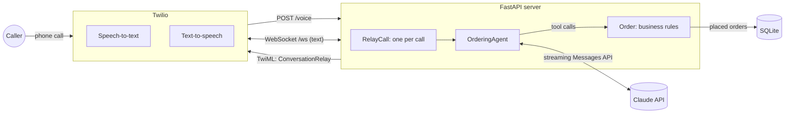
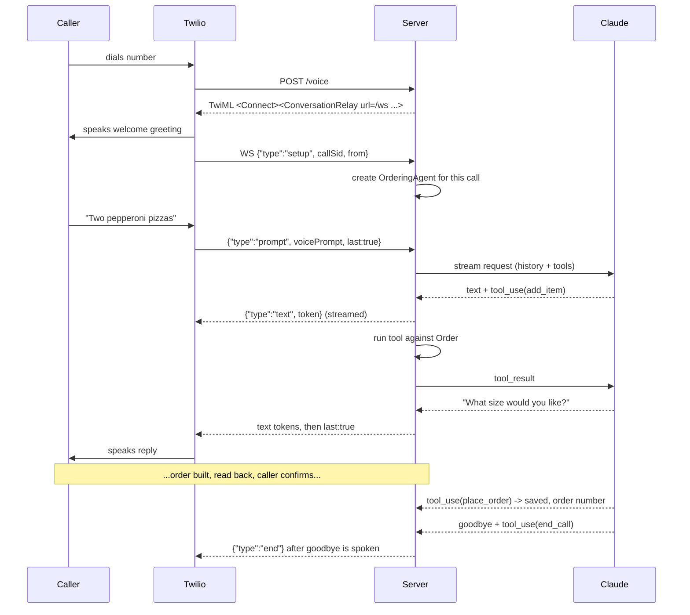

# High-Level Design: Phone Ordering Agent

Status: demo, not yet tested on a live call. Last updated: 2026-11-18.

## 1. Goal

Let a caller phone a restaurant and place a pickup order by talking to an AI agent.
The agent answers menu questions, builds the order, reads it back, places it after
the caller confirms, and gives an order number and pickup time.

**In scope:** pickup orders, menu questions, changing the order during the call.
**Out of scope (for now):** payment, delivery, reservations, complaints. The agent
says politely that this line only takes pickup orders.

## 2. Architecture

| Component | File | Responsibility |
|---|---|---|
| Twilio ConversationRelay | (Twilio) | Phone line, speech-to-text, text-to-speech, interruption detection. |
| Voice webhook | `ordering_agent/server.py` `/voice` | Answers the call with TwiML that connects it to ConversationRelay, including voice settings. |
| Relay session | `server.py` `RelayCall`, `/ws` | One per call. Turns relay messages into agent turns, streams reply text back, handles interruptions and hang-up. |
| Agent | `ordering_agent/agent.py` | Streaming Claude tool-use loop for one call. Yields text chunks as they arrive. |
| System prompt | `ordering_agent/prompts.py` | Speaking style for phone, ordering procedure, the full menu. |
| Tools | `ordering_agent/tools.py` | Tool schemas for Claude, input type checks, dispatch to the order. |
| Order | `ordering_agent/order.py` | Cart state and all business rules: valid items, required options, extras, quantities, tax, totals. |
| Menu | `data/menu.json`, `ordering_agent/menu.py` | Restaurant info and menu, rendered into the prompt deterministically. |
| Storage | `ordering_agent/storage.py` | Saves placed orders (SQLite). |
| Terminal client | `ordering_agent/cli.py` | Same agent without a phone, for testing. |

## 3. Call flow

**Interruptions:** when the caller talks over the agent, Twilio sends `interrupt`. The
server cancels the reply in progress, and the agent's next turn is told what the caller
actually heard.

## 4. Key design decisions

| Decision | Why |
|---|---|
| **Messages API, loop hosted in our server** (not Managed Agents) | Phone calls need the lowest latency: streaming tokens go straight to speech. The tools are local functions, so there's no need for a hosted sandbox. |
| **Twilio ConversationRelay** for speech | Twilio handles speech-to-text, text-to-speech and interruption detection. We only deal with text. The speech provider and voice are configuration, not code. |
| **Menu in the system prompt**, not a lookup tool | Menu questions need no tool round-trip, which saves latency. The prompt is identical across calls, so it's cached. |
| **All prices and rules in code** (`order.py`) | The model can't invent items, skip required options, or miscompute totals. Tool errors are returned to the model so it can ask the caller. |
| **Confirm before placing** | `place_order` requires `caller_confirmed: true` and the prompt requires a read-back first. |
| **Model `claude-opus-5-5` at `low` effort** | Short, quick turns for the phone. Effort and fast mode are configurable. |
| **Server-side refusal fallback** (`fallbacks: "default"`) | If a turn is declined, the API retries on a fallback model so the caller isn't left in silence. |
| **Streamed tool inputs** (`eager_input_streaming`) with our own validation | Lower latency. The API doesn't validate streamed inputs, so `tools.py` checks types and `order.py` checks rules. |

## 5. State and scaling

- **Per-call state** (conversation history, the order in progress) lives in memory on
  the call's WebSocket connection. A call stays on one server instance for its whole
  duration, so instances share nothing during a call.
- **Scaling out:** run more instances behind a load balancer that supports WebSockets.
  No sticky sessions or shared cache needed. One `AsyncAnthropic` client per process
  pools connections, and each call is a lightweight asyncio task.
- **Shared state** is only placed orders. SQLite is fine for one instance; use a shared
  database or send orders to the POS for more.
- **Limits to plan for:** Anthropic rate limits at peak concurrent calls, and Twilio
  concurrency on the account.

## 6. Data model

- **Order:** lines, customer name, caller phone (from Twilio, not from the model),
  order type (pickup), placed flag. Subtotal, tax and total are computed.
- **Line item:** line_id, menu item, quantity, chosen options, extras, kitchen notes,
  unit price (computed from the menu).
- **Saved order row:** order number, time, Twilio call SID, name, phone, total, full
  order summary as JSON.

## 7. Agent tools

| Tool | Effect |
|---|---|
| `add_item` | Add a menu item with options, extras, notes. Rejects unknown items, missing required options, invalid extras. |
| `remove_item` | Remove a line. |
| `update_quantity` | Change a line's quantity; 0 removes it. |
| `view_order` | Current lines, subtotal, tax, total. |
| `set_customer_name` | Name the order is under. |
| `place_order` | Save the order; requires caller confirmation, a name and at least one item. |
| `end_call` | Hang up after the goodbye. |

## 8. Configuration

All settings are environment variables; see `.env.example` and the README table.
Groups: Claude (model, effort, fast mode), voice (text-to-speech and speech-to-text
provider, voice, language, extra ConversationRelay attributes), Twilio (auth token,
public URL), storage (orders database, menu path), admin (`/orders` token).

## 9. Security

- `/voice` validates Twilio's request signature when `TWILIO_AUTH_TOKEN` is set.
- `/ws` rejects a bad signature, but doesn't yet require one (open issue).
- `/orders` (customer names and phone numbers) is off unless `ORDERS_API_TOKEN` is set.
- The caller's phone number comes from Twilio, never from the conversation.
- `RELAY_EXTRA_ATTRS` can't override `url` or `welcomeGreeting`.

## 10. Failure handling

| Failure | Behavior |
|---|---|
| Claude API error | Agent says it's having trouble and asks the caller to repeat. |
| Refusal (after fallback) | Agent politely steers back to the menu. |
| Unparseable streamed tool input | Turn retried up to twice, then the error line. |
| Runaway tool loop | Capped at 8 model rounds per caller turn. |
| Invalid tool input or rule violation | Error returned to the model, which asks the caller. |
| Caller hangs up | WebSocket closes, reply in progress is cancelled. |

## 11. Testing

`python -m pytest` runs with a scripted fake Claude client (`tests/fakes.py`), with no
API key or network. Coverage: order rules, tool validation, the agent loop, TwiML and
voice settings, signature rejection, and a full phone order over the WebSocket.

## 12. Open issues and next steps

- Not yet tested on a live call. ConversationRelay message field names were written
  from memory and need confirming.
- Hang-up delay after the goodbye is estimated from word count; tune after real calls.
- Require a Twilio signature on `/ws`.
- DTMF (keypad) input is ignored.
- Possible features: delivery, POS integration, SMS confirmation, payment.

## 13. Change log

| Date | Change |
|---|---|
| 2026-11-18 | Initial design: Claude Messages API agent, Twilio ConversationRelay, order tools, SQLite storage, terminal client. |
| 2026-11-18 | Text-to-speech and speech-to-text provider, voice and language made configurable via environment variables. |
| 2026-11-18 | Added this design document. |
