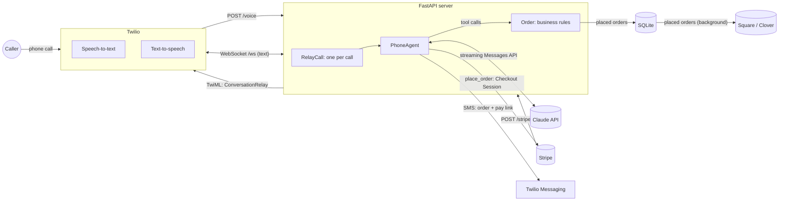

# High-Level Design: Ringcart (Phone Agent) for Businesses

Status: demo, hosted on Fly.io since 2026-11-18; no phone order saved yet. Last updated: 2026-11-23 (Hindi, Tamil, Kannada; greeting asks the language; side talk; background-noise settings; Indian English voice by default; event & wedding supplies template, guides, custom requests, Shopify).

## 1. Goal

Let a caller phone a business and get what they called for by talking to an AI agent.
Today that's ordering: the agent answers questions about what the business sells,
builds the order, reads it back, places it after the caller confirms, and gives an
order number and pickup time. It then texts the order details and a secure payment
link to the caller, so card details are never shared over the phone.

Businesses set themselves up in the browser (section 16): sign in with Google, upload
menu photos, test the agent, go live with their own number. The agent is generic: a
**template** (section 15) says what kind of business it is
(restaurant, shop; salons and other services are coming soon) and which **modules** it
uses (orders now; bookings later). The business itself enters its details and
catalog in the web manager (section 14). Restaurants were first, so examples below
often use them.

**In scope:** pickup orders, catalog questions, changing the order during the call,
payment by texted Stripe link (or at pickup).
**Out of scope (for now):** delivery, reservations, complaints, refunds. The agent
says politely that this line only takes pickup orders.

## 2. Architecture

| Component | File | Responsibility |
|---|---|---|
| Twilio ConversationRelay | (Twilio) | Phone line, speech-to-text, text-to-speech, interruption detection. |
| Voice webhook | `phone_agent/server.py` `/voice` | Finds the business by the dialed number (`To`) and answers with that business's greeting and TwiML that connects the call to ConversationRelay (business id in the `/ws` URL), including voice settings. Unknown numbers get a short apology and hang-up. |
| Business directory | `phone_agent/businesses.py` | Maps a dialed number or id to the business's current catalog (parsed catalogs cached by catalog version). Also the admin commands: add a business, publish a catalog, set its number, activate/deactivate. |
| Relay session | `server.py` `RelayCall`, `/ws` | One per call. Turns relay messages into agent turns, streams reply text back, handles interruptions and hang-up. |
| Agent | `phone_agent/agent.py` | Streaming Claude tool-use loop for one call. Yields text chunks as they arrive. Knows nothing about orders: it gets its tools and prompt from the business's modules. |
| Modules | `phone_agent/modules/` (`orders.py`; registry in `__init__.py`) | What a call can do. Each module owns its tools, their handlers, its prompt section and its per-call state. Built: `orders`. Coming soon: `bookings`. Section 15. |
| Call session | `phone_agent/session.py` | Per-call state (`CallSession`), the tool-schema helper, tool input checks, `ToolError`. |
| System prompt | `phone_agent/prompts.py` | The template's role and how to speak on the phone, then each module's section, then the catalog. |
| Tools | `phone_agent/tools.py` | The tools every call has (`end_call`), the tool list for a business, and the dispatcher that routes a tool call to its module. |
| Order | `phone_agent/order.py` | Cart state and all business rules: valid items, required options, extras, quantities, tax, totals. |
| Catalog | `phone_agent/catalog.py`; catalogs stored per business in the database, loaded from `data/businesses/<slug>.json` files | Business info and settings, optional business notes, and catalog, rendered into the prompt deterministically. Validated before it's saved. Items sold in several versions (e.g. chicken/fish/shrimp) are one item with a required option priced as deltas from the cheapest version. Tests use `tests/fixtures/catalog.json`. |
| Payments | `phone_agent/payments.py` | Creates a Stripe Checkout link per order, texts it with the order details via Twilio, applies Stripe webhook events (paid / expired) to the order. |
| Stripe webhook | `server.py` `/stripe/webhook`, `/paid` | Verifies Stripe's signature and updates payment and order status; `/paid` is the page shown after paying. |
| Storage | `phone_agent/storage.py` | Businesses, catalog versions, placed orders (order and payment status, per-business order numbers) and call transcripts, in SQLite. All SQL is in this file. |
| POS integrations | `phone_agent/pos.py`, `pos_square.py`, `pos_clover.py`; `server.py` `/pos/<provider>/callback` | Connects a business's Square or Clover account (OAuth, encrypted tokens), sends each placed order to it in the background with retries, records the online payment there, imports the POS catalog into a catalog file. Section 13. |
| Terminal client | `phone_agent/cli.py` | Same agent without a phone, for testing. |
| Self-serve | `phone_agent/onboarding.py`, `google_auth.py`, `catalog_import.py`, `menu_link.py`, `numbers.py`; `static/landing.html`, `static/manage.html` | Sign in with Google, create a business, read a menu from a link or photos (Claude), test chat, go live (buys a Twilio number or queues it for approval), team, orders and calls per business, POS connect, operator approvals, usage limits. Section 16. |
| Templates | `phone_agent/templates.py`; starters in `data/templates/` | What kind of business it is: modules (which tools a call gets), words, prompt role and rules, greeting, tags and settings changes. Section 15. |
| Catalog manager | `phone_agent/manage.py` (`/manage`, `/api/manage/...`), `static/manage.html`, `accounts.py`, `settings_schema.py`, `catalog_check.py` | Web page where business staff sign in and edit their own catalog (items, descriptions, prices, choices, extras, sold out) and settings. Edits autosave to a draft; publishing makes a new catalog version used from the next call. History with restore. Section 14. |
| Orders dashboard | `server.py` `/dashboard`, `/orders`, `/calls`; `phone_agent/static/dashboard.html` | Staff view of phone orders: today's count and sales, each order's items, total, order and payment status; filter, search, refreshes every 10 s. A Calls tab lists every call (with or without an order) and its transcript. The page holds no data and reads the API with the admin token. |

## 3. Call flow

**Payment rule (per business, `business.payment` in the business's catalog):**
- `required_before_cooking: false` (default): the order is confirmed right away; paying
  by link is optional and the caller can pay at pickup.
- `required_before_cooking: true`: the order is saved as `awaiting_payment` and only
  becomes `confirmed` when Stripe reports it paid. If the link expires unpaid
  (`pay_within_minutes`, 30 minutes to 24 hours, Stripe's limits), the order is
  `cancelled` and the caller gets a text saying so.

**Interruptions:** when the caller talks over the agent, Twilio sends `interrupt` (or
a new prompt arrives). If the reply is only talking, the server cancels it. If the model
has started a tool call (for example `place_order`, which also calls Stripe and Twilio),
cancelling would lose the order or leave a tool call without its result in the history,
so instead the reply is muted: the tool finishes, its result is recorded, nothing more
is spoken, and the server waits (up to 30 s) before handling what the caller said.
Either way the agent's next turn is told what the caller actually heard, and that any
tool results after that point haven't been announced.

**Transcripts:** every call gets a row in `calls` and a line in `call_events` for each
thing that happened, in order: the greeting, what the caller said (as Twilio heard it),
what the agent said (marked when cut off), each tool call with its input and result,
interruptions and the call's end. Staff read them on the dashboard's Calls tab. This
is how to find out why a call didn't produce an order.

## 4. Key design decisions

| Decision | Why |
|---|---|
| **Messages API, loop hosted in our server** (not Managed Agents) | Phone calls need the lowest latency: streaming tokens go straight to speech. The tools are local functions, so there's no need for a hosted sandbox. |
| **Twilio ConversationRelay** for speech | Twilio handles speech-to-text, text-to-speech and interruption detection. We only deal with text. The speech provider and voice are configuration, not code. |
| **Indian English voice by default** | Early callers are mostly Indian, and an American voice anglicizes dish names (Punugulu, Mirchi Bajji). English speech is an ElevenLabs Indian English voice on v4 speaking `en-IN` (`TTS_VOICE`, `TTS_LANGUAGE`); listening stays English (US). One setting for every business for now; per business later if needed. |
| **Background noise can't interrupt** | Twilio has no noise filter, and by default any sound cuts the agent off (a TV stopped a test call's greeting). The greeting is interruptible only by the keypad (`welcomeGreetingInterruptible=dtmf`, so "press 2" still works), interruption needs clearer speech (`interruptSensitivity=low`) and backchannels don't count (`ignoreBackchannel`). Env-overridable. Noise that is itself speech (a TV talking) can still be transcribed; the agent asks the caller to repeat. |
| **Catalog in the system prompt**, not a lookup tool | Catalog questions need no tool round-trip, which saves latency. The prompt is identical across calls, so it's cached. |
| **All prices and rules in code** (`order.py`) | The model can't invent items, skip required options, or miscompute totals. Tool errors are returned to the model so it can ask the caller. |
| **Confirm before placing** | `place_order` requires `caller_confirmed: true` and the prompt requires a read-back first. |
| **Model `claude-opus-5-5` at `low` effort** | Short, quick turns for the phone. Effort and fast mode are configurable. |
| **Pay by texted Stripe Checkout link**, not card details by voice | Customers never read card numbers to an AI or over a phone line, and we never handle card data (Stripe does). The link has the exact items and total. |
| **Templates and modules, as code** (section 15) | Kinds of business differ in wording, prompt rules and what a call does. A template per kind (with its business rules in code) keeps the agent precise; a fully generic schema would make it vague and validation weak. |
| **Pay-first is a business setting** | Some businesses want prepayment to avoid no-shows, others don't. It's a rule in the catalog file, enforced in code, and the prompt tells the caller which applies. |
| **Server-side refusal fallback** (`fallbacks: "default"`) | If a turn is declined, the API retries on a fallback model so the caller isn't left in silence. |
| **Streamed tool inputs** (`eager_input_streaming`) with our own validation | Lower latency. The API doesn't validate streamed inputs, so `tools.py` checks types and `order.py` checks rules. |

## 5. State and scaling

- **Per-call state** (conversation history, the order in progress) lives in memory on
  the call's WebSocket connection. A call stays on one server instance for its whole
  duration, so instances share nothing during a call.
- **Scaling out:** run more instances behind a load balancer that supports WebSockets.
  No sticky sessions or shared cache needed. One `AsyncAnthropic` client per process
  pools connections, and each call is a lightweight asyncio task.
- **Shared state** is only placed orders. SQLite is fine for one instance; use a shared
  database or send orders to the POS for more.
- **Simultaneous calls:** a Twilio number is not a single line. Every incoming call gets
  its own `/voice` request and its own WebSocket, so several callers can order at once and
  nobody gets a busy signal. On our side each call is one WebSocket; `fly.toml` caps a
  machine at 100 connections (soft limit 50). If a business forwards its existing
  number to ours, its phone carrier decides how many calls it forwards at once; check
  that per business.
- **Limits to plan for:** Anthropic rate limits at peak concurrent calls, and Twilio
  concurrency on the account.
- **Hosting:** Fly.io (`Dockerfile`, `fly.toml`), one always-on `shared-cpu-1x` machine
  in `ord` (Chicago) with a 1 GB volume at `/data` for `phone_agent.db`. Always on because a
  cold start would leave a caller in silence; one machine because SQLite lives on one
  volume. Secrets are Fly secrets, never in the image (`.dockerignore` excludes `.env`
  and local databases). Live at `https://phone-agent-604b.fly.dev` (region
  `ord`); the Twilio number's voice webhook points there.
  Local development still works with uvicorn plus a tunnel.

### Isolation between businesses

One deployment serves every business, so nothing one business does or suffers may
reach another:

| Shared thing | How businesses are kept apart |
|---|---|
| Data | Every business-owned row has `business_id`; queries take it as a parameter. Order numbers count per business. A catalog version is only looked up within its business. |
| Access | Staff only see their businesses (`user_businesses`; others' ids return 404). POS connect links are signed for one business. The operator token sees all. |
| Calls | A call's WebSocket is bound to the business `/voice` chose for that call (signed token) and must match the dialed number. Each call has its own agent, order and history. |
| Bad data | A catalog that can't be loaded takes only its own business offline. Catalogs are validated before they're saved. |
| Capacity | `MAX_CALLS_PER_BUSINESS` (default 20) concurrent calls per business, so one busy business can't use up the server's connections or the shared Claude rate limit. |
| Background work | POS jobs never sleep in a worker (retries wait on timers), and a business has at most 2 POS jobs running, so a slow or failing POS only delays its own orders. |
| Analytics | Events and metrics are keyed by `business_id`; call reviews run one at a time per business with a daily cap per business, so one busy business can't delay or run up costs for another's reviews. |
| Menu reading | Readings are async jobs (no worker thread held), one per business at a time, with a daily limit per business; a job id from another business answers 404. |
| Errors | Lookups and agent start-up are wrapped per call; logs name the business. |

Still shared, and the limits that come with it (section 18): one Anthropic API key and
rate limit, one Stripe account and one SMS sender number (phase 3), one SQLite file with
one lock, and one machine.

## 6. Data model

- **Business:** id, slug (e.g. `hyderabad-house`), the Twilio number callers dial
  (unique), active flag, current catalog version.
- **Catalog version:** business, time, the full catalog JSON (items plus the settings
  block: name, hours, address, time zone, tax rate, pickup minutes, payment rule, `about`
  and `faq`). Items can carry ordering rules: `days` (days of the week it can be picked
  up), `notice_days` (days ahead it must be ordered) and `in_person_only`, enforced by
  `order.py` through `schedule.py`. Day based on purpose: no time-of-day windows.
  Publishing a catalog adds a version; old ones are kept.
- **Order:** lines, customer name, caller phone (from Twilio, not from the model),
  order type (pickup), placed flag. Subtotal, tax and total are computed.
- **Line item:** line_id, catalog item, quantity, chosen options, extras, kitchen notes,
  unit price (computed from the catalog).
- **Saved order row:** internal id, business, per-business order number (each
  business's first order is #1), time, Twilio call SID, name, phone, total, full
  order summary as JSON, order status (`confirmed` / `awaiting_payment` / `cancelled`),
  payment status (`not_requested` / `unpaid` / `paid` / `expired`), Stripe Checkout
  Session ID and URL, paid time, the catalog version it was taken from, and structured
  lines (item ids, options, extras) for sending it to a POS. POS fields: status
  (empty when no POS is connected, `held` until paid for pay-first businesses,
  `pending`, `sent`, `failed`), the POS's order id,
  the last error, attempts, and whether the online payment was recorded on the POS.
- **POS connection:** business (one each), provider (`square` / `clover`),
  environment (`sandbox` / `production`), merchant and location ids, access and refresh
  tokens encrypted with `POS_SECRET_KEY`, settings picked at connect time (Clover's
  pickup order type and default tax rate; Square's location currency).
- **Catalog item POS ids** (optional, written by a catalog import): `pos.item` (Square item
  variation or Clover item), `pos.choices` (each option choice to a variation or
  modifier id), `pos.extras`, and `pos_key` (keeps our item id stable across
  re-imports). The catalog's top-level `pos.provider` says which POS they belong to.
- **User:** email (unique), name, scrypt password hash (empty until they accept their
  invite), active flag; linked to one or more businesses (`user_businesses`, role
  `manager`).
- **Auth token:** SHA-256 of a session or invite token, kind, user, expiry (sessions 14
  days, invites 72 hours).
- **Catalog draft:** one per business: the edited catalog JSON, the live version it started
  from, a revision number (for conflict checks), who and when last saved. Published
  catalog versions record who published them (`created_by`: an email or `operator`).
- **Self-serve (schema version 2):** `users.google_sub` (the Google account, unique);
  `user_businesses.role` is `owner` or `manager`; `go_live_requests` (business, who,
  area code, status `pending`/`done`/`failed`/`rejected`/`approved`, number, error);
  `usage` (scope `global` / `user:<id>` / `business:<id>`, day, kind, count) for limits.
  A new self-serve business has no catalog version and no number until it publishes and
  goes live.
- **Schema changes:** numbered steps in `Store._migrate`, applied once per database
  (`PRAGMA user_version`). Version 1 is the base schema; version 2 added the self-serve
  tables. Add a new step for every change; never edit a shipped one.
- **Template:** the catalog JSON's top-level `template` key (`restaurant` when missing);
  it's versioned with the catalog.
- **Catalog JSON:** `{"template": ..., "settings": {...}, "items": [...]}` (plus `pos` after a
  POS import). `settings` is the block the settings form edits (section 14).
- **Tables:** `businesses`, `catalog_versions`, `catalog_drafts`, `orders`, `calls`,
  `call_events`, `pos_connections`, `users`, `user_businesses`, `auth_tokens`, in
  `phone_agent.db`. The schema is created in full on first start; there are no
  migrations yet (the database was started fresh on 2026-11-22). Add a migration step
  before changing the schema of a database with real data.
- **Catalog item extras:** `available: false` marks an item unavailable (sold out / out of stock) (the agent says so and
  `add_item` refuses it); `settings.greeting` overrides the opening line.
- **Call row:** Twilio call SID, business, start and end time, caller phone, order number (if any).
- **Call event:** call SID, time, role (`caller` / `agent` / `tool` / `event`), text
  (at most 4,000 characters).
- **Phone numbers** are stored in E.164 form (`+15551234567`).

## 7. Agent tools

| Tool | Effect |
|---|---|
| `add_item` | Add a catalog item with options, extras, notes. Rejects unknown items, missing required options, invalid extras, in-person-only items, and items whose days or notice don't fit the pickup. |
| `remove_item` | Remove a line. |
| `update_quantity` | Change a line's quantity; 0 removes it. |
| `view_order` | Current lines, subtotal, tax, total. |
| `set_customer_name` | Name the order is under. |
| `set_customer_phone` | Mobile number for the text, when it differs from caller ID or caller ID is hidden. Must be a full number. |
| `set_pickup_time` | Schedule the pickup for a later day and time (business time), or clear it for as soon as possible. Refused if sooner than the ready time, further ahead than the business allows (`settings.max_advance_days`, default 30, up to 365), or if an item on the order can't be picked up then (its days or notice, up to 120 days). |
| `place_order` | Save the order; requires caller confirmation, a name, at least one item, and (with payments on) a phone number. Then creates the payment link and texts it; the result tells the agent whether it was sent. |
| `read_guide` | (guides module) The text of one of the business's guides, by title; only titles are in the prompt. Lists the titles if none matches. |
| `record_inquiry` | (inquiries module) Save a custom request for staff to quote on: summary, details, event date, budget, name, phone (caller ID unless given). Requires the caller's confirmation; refuses a past or malformed event date. Texts the business's `notify_phone` in the background. |
| `end_call` | Hang up after the goodbye. |

## 8. Configuration

All settings are environment variables; see `.env.example` and the README table.
Groups: Claude (model, effort, fast mode), voice (text-to-speech and speech-to-text
provider, voice, language, extra ConversationRelay attributes), Twilio (auth token,
public URL, account SID and SMS sender number), Stripe (secret key, webhook secret),
storage (database file; catalog file for the terminal chat), admin (`/orders` token),
POS (`POS_SECRET_KEY`, which turns POS sending on and encrypts tokens; Square, Clover
and Shopify app credentials and environment), branding (`BRAND_NAME`, the product name on every
page), `DEFAULT_TIMEZONE` (for businesses without `settings.timezone`). Payment links are on
only when `STRIPE_SECRET_KEY` and the Twilio SMS settings are all set; otherwise
customers pay at pickup. Per-business settings (tax, pickup time, how far ahead pickups
can be scheduled, pay-first rule, hours, about, common questions, guides, the staff number
for request texts) live in each business's catalog, not in environment variables.

## 9. Security

- `/voice` validates Twilio's request signature when `TWILIO_AUTH_TOKEN` is set.
- `/ws` only starts a call that `/voice` issued: the WebSocket URL carries a token (HMAC
  of business id, call SID and expiry, keyed from `TWILIO_AUTH_TOKEN`, valid 10 minutes)
  that must match the business in the URL and the call SID in Twilio's setup message.
  The dialed number must also belong to that business. Anything else hears "this
  number isn't taking orders" and is hung up. A bad Twilio signature, if present, is
  still rejected. (Without `TWILIO_AUTH_TOKEN`, for local development, tokens are off.)
- Every order and call row carries its business, and the APIs filter by it. Until
  staff logins exist, the single `ADMIN_API_TOKEN` sees every business, so only the
  operator should have it.
- `/orders`, `/calls` and `/dashboard` (customer names, phone numbers, call
  transcripts) are off unless `ADMIN_API_TOKEN` is set. The dashboard page has no data in it; it sends the token
  (kept in the browser's local storage) as a Bearer header, compared in constant time.
- The phone number defaults to caller ID from Twilio. The caller can give a different
  number for the text (`set_customer_phone`); the agent reads back the last four digits
  before placing the order.
- No card data touches this server or the call: payment happens on Stripe's page.
- `/stripe/webhook` is off unless `STRIPE_WEBHOOK_SECRET` is set, and rejects events
  without a valid Stripe signature. Retried events don't change state twice or send
  duplicate texts.
- `/manage`: staff sign in with email and password (scrypt; 10+ characters), set from a
  one-time invite link (token in the URL fragment, so it isn't logged). Sessions are
  random tokens in an HttpOnly, SameSite=Lax cookie (Secure on https); only hashes are
  stored. Failed sign-ins are limited per email and per IP (8 per 15 minutes). Writes
  need an `X-Manage` header and a matching Origin (CSRF). Each user only sees their own
  businesses (other ids return 404); the operator can use `ADMIN_API_TOKEN` as a
  Bearer token. The page is served with a strict CSP, `X-Frame-Options: DENY` and
  `no-store`. Every save is validated on the server (catalog_check.py), whatever the page
  sends.
- Sign in with Google: authorization code flow with PKCE; state and verifier in a
  signed, HttpOnly, 10-minute cookie; only Google-verified emails; an email already on a
  team (or with an older account) is linked to the Google account on first sign-in, and
  an email linked to a different Google account is refused. Then the same session cookie
  as password sign-in.
- Roles: owners take the line live, pause it, manage the team and connect the POS;
  managers edit the catalog and settings and see orders and calls. Operators
  (`OPERATOR_EMAILS`, or the admin token) are owners everywhere and approve go-live
  requests.
- Spending limits (env-tunable, counted atomically in `usage`): businesses per account,
  automatic phone numbers per account and per day across everyone (the rest wait for an
  operator), menu reads and test-chat turns per business per day, team size. Uploads are
  capped (10 files, 20 MB) and only JPEG/PNG/WebP/GIF/PDF are accepted.
- Menu links (`menu_link.py`) make the server fetch an address a stranger typed, so each
  hop (redirects are followed by hand, at most 4) must be http(s) on a standard port with
  no credentials, and its host must resolve only to public addresses (no loopback,
  private, link-local, carrier-grade NAT or metadata ranges; IPv4-mapped IPv6 unwrapped).
  Downloads are capped at 8 MB and 20 seconds; only the page's visible text (no scripts)
  goes to Claude, as a text document.
- `RELAY_EXTRA_ATTRS` can't override `url` or `welcomeGreeting`.
- POS access tokens are encrypted at rest (Fernet, `POS_SECRET_KEY`); losing the key
  means reconnecting every business. Connect links carry an HMAC-signed state naming
  the business and expire after an hour, so a callback can't attach a POS to the wrong
  business. Sandbox tokens for testing are read from `POS_ACCESS_TOKEN`, never from
  the command line.

## 10. Failure handling

| Failure | Behavior |
|---|---|
| Claude API error | Agent says it's having trouble and asks the caller to repeat. |
| Refusal (after fallback) | Agent politely steers back to the catalog. |
| Unparseable streamed tool input | Turn retried up to twice, then the error line. |
| Runaway tool loop | Capped at 8 model rounds per caller turn. |
| Invalid tool input or rule violation | Error returned to the model, which asks the caller. |
| Caller hangs up | WebSocket closes. A reply that is only talking is cancelled; one mid tool call finishes first, so a confirmed order is still saved. The call's end is recorded. |
| Caller interrupts mid tool call | The tool finishes silently, then the agent answers the new speech knowing what wasn't heard. If it takes over 30 s it's cancelled. |
| Transcript write fails | Logged; the call carries on. |
| Stripe or SMS fails at `place_order` | The order is still saved. The agent tells the caller the text didn't go through and they can pay at pickup (pay-first businesses: the order starts when they pay at the counter). |
| Text after payment fails | Logged; payment status is still updated. |
| POS unreachable, rate-limited or 5xx | The call isn't affected (sending runs in the background). Retried after 5 s, 30 s, 2 min and 10 min; the dashboard shows "Sending to POS" / "Not on POS" with the error. Orders not sent are resent on server start (last 6 hours) or with `pos retry`. Square requests use idempotency keys; Clover partial orders are deleted before retrying. |
| POS rejects the order (other 4xx) | Not retried; shown as "Not on POS" with the error for staff. |
| One business's catalog can't be loaded | Only that business goes offline: its callers hear "this number isn't taking orders", it's logged at startup and shown as `broken` in `/businesses` and `businesses list`. Every other business keeps working. |
| Unexpected error looking up or starting a call | Caught per call: that caller hears the short apology; other calls aren't affected. |
| Reading a menu (photos, PDF or link) fails, is refused, or is too long | The owner sees a plain message (try clearer photos, fewer pages, photos instead of a link, or again); the draft is unchanged. |
| Buying a number fails (none in that area code, Twilio error) | The owner sees a message (try a nearby area code); a `failed` request is recorded; no number, nothing charged. |
| One business gets more calls than `MAX_CALLS_PER_BUSINESS` | New callers to that business hear "all our lines are busy"; other businesses still answer. |

## 11. Testing

`python -m pytest` runs with a scripted fake Claude client (`tests/fakes.py`), with no
API key or network. Coverage: order rules, tool validation, the agent loop, TwiML and
voice settings, signature rejection, a full phone order over the WebSocket, phone
number checks, both payment rules (optional and pay-first), link/SMS failure, Stripe
webhook signature checks and duplicate events (with fake Stripe and SMS), an
interruption during `place_order` (order still saved, history stays valid), call
transcripts through `/calls`, and multiple businesses: routing by dialed number,
unknown and inactive numbers, per-business order numbers, API filtering, payment texts
in the right business's name, and admin-command
validation. POS tests (fake Square and Clover APIs over `httpx.MockTransport`): order
bodies, catalog-linked lines and modifiers, retries with one idempotency key, permanent
rejections, external payment after Stripe, Clover partial-order cleanup, token refresh,
encrypted tokens, signed connect state, the OAuth callback, catalog import (and keeping item
ids on re-import), and admin commands. Not yet tried against the real sandboxes. Catalog manager tests: invites and sign-in, password rules, rate limiting, disabled users,
CSRF header and Origin checks, access to other businesses, operator token, draft
revisions and conflicts, publish reaching the next call (greeting, new item, sold-out
item refused), errors blocking publish, publishing over a newer catalog, restore and
discard, page security headers, and the checks on the real catalog. Self-serve tests
(`tests/test_onboarding.py`, fake Google, Claude and Twilio): Google sign-in (new account,
linking a teammate added by email, unverified email, forged state, failed token
exchange), creating a business and its limits, reading menu photos into the draft (and
file type and daily limits), test chat without saving, going live within the free
limit, queuing past it and operator approval, the daily number limit, owner-only actions,
team management, and orders and calls scoped to the business. Template tests: valid starters, the
retail wording in the prompt and greeting, out-of-stock refusal, the coming-soon and
unknown templates refused, tools per module, settings labels per template, the editor
API sending the template, and the business prompt unchanged by the refactor. Isolation tests
(`tests/test_isolation.py`): a broken catalog leaves other businesses working, catalog
versions stay within their business, `/ws` refuses missing, foreign and expired call
tokens and a mismatched dialed number, call limits are per business and freed when a
call ends, a hung POS for one business doesn't delay another's orders, retries don't
block workers, and tools of modules a template doesn't use are refused.

## 12. Multi-business plan (phase 1 built, except Postgres)

Goal: one deployment serves many businesses. Each call is routed to one business,
and each business's catalog, settings, orders, transcripts, staff and money are kept
separate. The agent, tools and order rules are already business-neutral (everything
business-specific is in the business's catalog file), so the change is mostly data, routing and
accounts.

**What changes**

| Today | Multi-business |
|---|---|
| One catalog file, loaded at startup | `businesses` table plus versioned catalogs in the database, loaded per call and cached |
| One Twilio number to `/voice` | A number per business; the dialed number (`To`) selects the business |
| Orders and calls have no business column; one order-number sequence | `business_id` on every row; order numbers counted per business |
| One shared dashboard token | Staff logins scoped to one business |
| One Stripe key; all money to one account | Stripe Connect: each business connects its own Stripe account and is paid directly; optional platform fee |
| One SMS sender | The business's own number sends its texts; A2P 10DLC registration per business brand (Twilio ISV flow) |
| SQLite on one machine | Postgres (multiple machines, backups) |
| Tax, hours, pickup time, pay-first rule in the catalog file | Per-business settings, editable in an admin page |

**Call routing**

1. `/voice` (Twilio-signed) looks up the business by the dialed number and returns
   that business's greeting. Unknown number: a short apology and hang up.
2. The `/ws` URL in the TwiML carries the business ID. Twilio signs that URL, so the
   `/ws` signature becomes required (it is optional today).
3. The agent is built from that business's catalog, settings and payment account. The
   system prompt differs only in the catalog block, so prompt caching works per business.
4. Orders, transcripts, texts and payment links are tagged with the business; the
   Stripe webhook (Connect events carry the connected account) finds the order through it.

Businesses can keep their published number and forward calls to ours, either always or
only when staff don't pick up ("no answer" forwarding is an easy first step for them).

**New components**

- Onboarding: catalog photos to structured catalog data with Claude vision, then a review screen
  where the business confirms prices and required options before going live.
- Business admin: catalog editing, "sold out today", hours (the agent knows when the
  business is closed), tax, pickup time, pay-first rule, voice.
- Kitchen hand-off: the dashboard first; POS connectors (Toast, Square, Clover) later, one
  adapter per POS.
- Tenant-isolation tests: no query, endpoint or webhook may return another business's data.
- Later: billing businesses for the service (Stripe Billing).

**Phases**

1. **Done 2026-11-22 (on SQLite):** businesses table, routing by dialed number,
   `business_id` on orders and calls, per-business order numbers, versioned catalogs
   in the database, admin commands, business picker on the dashboard. Hyderabad House
   is business #1. **Still to do:** move to Postgres (provider not chosen; Netlify
   Database was looked at and isn't a fit, since it's tied to apps deployed on Netlify;
   Neon directly or Fly Managed Postgres are the candidates).
2. Staff logins and per-business dashboards. **Started 2026-11-22:** staff accounts and
   the catalog manager (section 14). The orders dashboard still uses the shared token.
3. Stripe Connect and per-business SMS (needed before payment links go live for anyone).
4. Onboarding from photos and the admin page, so business #2 needs no hand-edited JSON.
   The catalog manager (section 14) now covers editing after onboarding.
   Until then, onboarding is done with the Claude Code skill
   `.claude/skills/add-business/` (catalog file from photos, `check_catalog.py`, Twilio
   number, registration on Fly, signed test call). Catalog files live in git at
   `data/businesses/<slug>.json` and ship in the image; `business.placeholders` and
   `placeholder_price` mark guessed values, which the checker blocks on.
5. POS integrations: Square and Clover built (section 13); Toast application drafted.

**Decisions**

- Phone numbers: bought in our main Twilio account, one per business (decided
  2026-11-22). Subaccounts can come later if billing needs separating.
- Chains: not in scope for now; each business is one location (decided 2026-11-22).
  A chain's locations can be separate businesses; a brand level can be added later.
- Database: Postgres provider still to choose.

## 13. POS integrations

Phone orders go onto the business's own point of sale, so the kitchen works from the
system it already uses, and a catalog can be imported from the POS instead of typed in.
Code: `phone_agent/pos.py` (connections, background sending, import, admin
commands), `pos_square.py`, `pos_clover.py`, `pos_shopify.py`.

**Connecting.** The owner clicks Connect in Settings (or the operator runs
`pos connect-link SLUG square|clover|shopify [--shop STORE]` and sends them the link) and
approves access (OAuth). Shopify asks for the store's `.myshopify.com` address first. The callback (`/pos/<provider>/callback`)
stores the tokens encrypted and picks the location (Square, when there's one) or the
pickup order type and default tax rate (Clover). Square tokens last 30 days and are
refreshed a week early; Clover's are short-lived and refreshed when within 5 minutes.
For sandbox testing, `pos connect-token` stores a token from `POS_ACCESS_TOKEN`.

**Sending orders.** After `place_order` saves the order, it's queued for the POS and
sent by a small thread pool; the caller never waits. For a pay-first business the
order is held until the payment link is paid, so the kitchen never sees an unpaid
order (if the link expires it never reaches the POS; if the text failed, staff see it
only on our dashboard). Lines from an imported catalog go as
catalog items with their modifiers; anything else goes as a custom line with our name
and price. The order total and tax on the POS come from the POS for catalog items, so a
catalog that is out of date with the POS can show a different total there; re-import after
POS price changes.

| | Square | Clover |
|---|---|---|
| Order | Orders API, PICKUP fulfillment (ASAP, prep time from the catalog), ticket name `Phone #N Name`, order-level sales tax at the catalog's rate. | v3 order, state open, title `Phone #N Name`, pickup order type, total; one line per unit (bulk), then modifiers. |
| Shows on the POS | **Only once paid** (a Square rule), so callers pay by a Square payment link (above). | Immediately. |
| Payment link paid | The Square link's own order opens; nothing to record. (Older path, with a Stripe link: an EXTERNAL payment for Square's order total.) | Order note becomes "PAID ONLINE". |
| Retries | Idempotency keys from our order id. | Partial order deleted, then recreated. |
| Catalog import | Catalog: variations become a required `size`/`type` option, single-select modifier lists become options, multi-select become extras; variable-price items skipped. | Items with modifier groups (max 1 is an option, otherwise extras); hidden and variable-price items skipped. |

**Shopify (`pos_shopify.py`, Admin GraphQL API 2026-10).** For online stores, e.g. an
event supplies shop already selling on Shopify. Built like Square's payment link
(`LinkPayments`, `pays_by_link` on the provider):
- Connect: Shopify OAuth for one store (scopes `read_products`, `write_draft_orders`,
  `read_orders`), offline token (doesn't expire). The callback's `hmac` is checked with
  the app secret and the `shop` must be a `.myshopify.com` address; the merchant id is the
  shop address. `setup` reads the shop's name and currency.
- Import: active products, 50 per page; the cheapest variant is the price, and variants
  become one required option (named after the product's option, e.g. `length`, or
  `choice` with the variant titles when there are several option names). Product type is
  the category. Ids kept (`pos.item`, `pos.choices`).
- Order: `place_order` creates a **draft order** (`draftOrderCreate`): variant lines for
  linked items, custom lines with our price otherwise (and when extras were added), the
  phone order note, item notes, tags and attributes (phone order number, pickup time,
  phone). Its checkout link (`invoiceUrl`) is texted; the caller pays on Shopify's page,
  into the store's account, and Shopify turns the draft into an order. We poll the draft
  every 20 seconds: paid when it has an `order`; past the window it's deleted
  (`draftOrderDelete`) and the order cancelled. Payment is always required, as for Square.
- Shopify works out tax at checkout from the store's tax settings, so the amount paid can
  differ from the total the agent read out. Pickup isn't a delivery method on the draft
  (only written in the note and attributes), so if the products need shipping, Shopify's
  checkout may ask for an address: to check on a real store.
- Not yet tried against a real store (needs a Shopify app and a development store).

**Square businesses pay by Square payment link (required).** Square only shows orders
from other apps once they're paid, so for a business connected to Square every phone
order is paid by a **Square payment link** (`payments_for` in `pos.py`, chosen per call):
- `place_order` saves the order, then `SquarePayments` asks Square for a payment link
  (Checkout API) built from the order: lines, sales tax, PICKUP fulfillment with the
  pickup time, the caller's number prefilled. Square creates the order itself as a draft,
  invisible to staff; we don't create a second one.
- The link is texted from the shared number. The money goes straight to the business's
  Square account; we never handle it.
- `PosHub` checks the order every 20 seconds (`check_payment`, on the same per-business
  gated timers as sending). Paid (Square opens it with a tender): our order is confirmed,
  marked on the POS and paid, and the customer gets a text; it's now on the register like
  any paid online order. Past the business's payment window: the link is deleted (Square
  cancels its draft), the order is cancelled and the customer is told. Square being
  unreachable only delays the check; an hour past the window we give up locally.
- Waiting links are watched again after a restart (`orders_awaiting_link`).
- The business's "wait for payment" setting is forced on for these calls (shown as
  "Always on with Square" in Settings). Needs the texting number (`TWILIO_SMS_FROM`);
  without it a Square business falls back to the server-wide payment setting.
- Open question, to settle with businesses: pay at pickup for Square owners (the order
  would be in Ringcart only, staff key it in), or a $0 / external-payment workaround.

**Importing a catalog.** The owner clicks "Import catalog" in Settings
(`POST /api/manage/businesses/{id}/pos/import`): the draft's items are replaced by the POS's,
settings kept, and they review and publish as usual. Or the operator runs
`pos import-catalog SLUG > data/businesses/SLUG.json`, which writes a catalog
file using the business's current settings block (or `--base`), then it goes through
the normal checker, review, commit, deploy and `set-catalog`. Item ids of items imported
before are kept (matched by POS id), since old orders refer to them. Imported items have
no vegetarian/spice tags; add them in review.

**Decisions**

- Square and Clover first: both open self-serve developer platforms (2026-11-22).
  Toast needs the partner program (application drafted in
  `docs/toast-partner-application.md`); Lightspeed and others later, or through a
  middleware such as Deliverect or Otter.
- The POS doesn't replace our dashboard: failed sends, and orders waiting for payment,
  are only visible there.
- Square businesses take payment through Square, not our Stripe account (2026-11-22):
  the money never passes through us, and it's the only way their orders show on Square.
  Payment links are checked by polling, not Square webhooks, so nothing needs setting up
  per app; webhooks would cut the 20-second delay.

## 14. Catalog manager (business web interface)

Business staff edit their own phone catalog and settings at `/manage`, without us
editing JSON files.

**Accounts.** The operator invites people with
`python -m phone_agent.accounts invite EMAIL --business SLUG`, which prints a
one-time link where they choose a password. Resetting a password is the same command.
`list`, `grant`, `revoke`, `disable` manage access. A person can manage several
businesses (a picker appears).

**Editing.** The page loads the business's draft (or the live catalog), and every change
is saved to the draft about a second later. Callers keep hearing the live catalog until
someone presses Publish, which validates the draft, stores it as a new catalog version
(recording who published it) and deletes the draft; the next call uses it, with no
restart. Discard drops the draft; History lists published versions and can restore one
into the draft.

- Catalog tab: items by section, search, filters (sold out, estimated price), a
  sold-out switch on every item, rename a section, add/delete items. The item panel
  edits name, section, price, description (with tag chips such as Vegetarian, Spicy,
  Contains nuts), availability, choices (required or not, each option with its added
  price) and extras. New items get an id from their name; ids never change after that.
  Changing an estimated price, or pressing "It's right", clears the estimate flag.
- Settings tab: built from `settings_schema.py` (name, greeting, address, hours,
  pickup time, sales tax, pay-first rule, link validity, notes for the agent).
  Estimated settings show a confirm prompt.
- Checks (`catalog_check.py`, shared with the add-business skill) run on every save:
  errors (out-of-range values, missing names or prices, bad choices) block publishing;
  "please confirm" items (estimated prices or settings, no tax) and suggestions are shown.

**Adding a setting later:** add an entry to `SETTINGS` in `settings_schema.py` (path,
type, label, help, limits) and read it where it's used. The form and server-side
validation follow automatically. Supported types: text, textarea, integer, percent,
boolean, string_list.

**Conflicts.** Each draft save carries the revision it was based on; a stale one gets
409 and the page asks to reload. If someone published a newer catalog after the draft was
started (for example the operator or a POS import), publishing asks for confirmation
before replacing it.

**Decisions**

- Draft then publish, rather than live edits, so a half-finished change never reaches
  callers (2026-11-22).
- Invite links instead of operator-chosen passwords, and no email provider yet: the
  operator sends the link (2026-11-22).
- One plain HTML page with no build step, like the dashboard.

## 15. Business templates (making the agent generic)

The core works for any business: phone calls, routing by number, transcripts, staff
sign-in, the web manager, payment links, dashboard, POS. What differs by kind of
business is a **template** (`phone_agent/templates.py`):

| Part | What it is | Example (restaurant / shop) |
|---|---|---|
| `modules` | What a call can do (`phone_agent/modules/`). Each module brings its tools, their handlers (business rules in code), its prompt section and its per-call state. | `orders`, `guides`, `inquiries` (all three templates) |
| `words` | How the manager and the agent name things. | menu, dish, section, "sold out today" / catalog, product, category, "out of stock" |
| `role`, `rules`, `declines` | The agent's role line, extra rules, and what it politely declines. | "phone ordering assistant", declines delivery and reservations / declines shipping, returns |
| `greeting` | Default first line (a business can set its own). | "What can I get started for you today?" / "How can I help you today?" |
| `tags` | Description tag chips in the editor. | Vegetarian, Spicy / Bestseller, Gift-wrappable |
| `setting_overrides`, `extra_settings` | Changes to the settings form (labels, help) and settings only this kind of business has. | "Restaurant name", "Wait for payment before cooking" / "Business name" |

A business's template is the `template` key of its catalog JSON. Starter catalogs are
in `data/templates/<id>.json`; `python -m phone_agent.businesses templates` lists
them. The prompt is assembled from the phone rules (shared), the orders rules with
the template's words, the template's role and rules, the payment rule and the catalog.
For restaurants it's byte-for-byte the prompt from before templates.

**Templates now:** `restaurant`, `retail` (shops: bakeries, florists, liquor, gift and
convenience stores) and `events` (event and wedding supplies: garlands, flowers, ceremony
items and sets) are available. `events` is for consultative selling: the agent asks the
event date and ceremonies, suggests what's usually needed (from the catalog and the
guides) a little at a time, offers a set or package that covers it, schedules the pickup
for when it's needed, and takes custom work as a request. Its starter allows pickups 180
days ahead and items with up to 120 days' notice.

**Modules every available template has:**
- `orders`: the cart, pickup and payment (sections 3, 7 and 13).
- `guides` (`modules/guides.py`): the business's longer write-ups (`settings.guides`, a
  list of `{title, text}`, up to 30 of 6,000 characters), e.g. a ceremony checklist, garland
  sizes, how far ahead to order. Only the titles are in the system prompt; the agent calls
  `read_guide` for the text, so the prompt stays short and cached however much a business
  writes. Edited under Settings > What your agent knows; the menu reader drafts them from
  a business's pages (flagged until confirmed, like drafted questions). No guides: no
  prompt section.
- `inquiries` (`modules/inquiries.py`): custom requests for what the catalog can't price
  (custom designs, setups, rentals, catering, large quantities). The agent collects what,
  when, how many, style, budget and name, reads it back and calls `record_inquiry`, and
  tells the caller the team will get back to them; it never promises a price. Saved in the
  `inquiries` table (per business, numbered per business, status new / contacted / closed),
  listed in the manager's **Requests** tab, and texted to the business's `notify_phone`
  (Settings > Requests) in a background thread from the shared SMS number. Test chats
  (browser and terminal) don't save requests, as they don't save orders.

The agent is also given the year with today's date, so a date without a year ("March
14th") is read as the next one. `salon` (services and appointments) is listed as
**coming soon**: it needs the `bookings` module, so `parse_catalog` refuses it and it can't
be registered.

**Adding a kind of business** that only needs orders: a `Template` entry and a starter
file. **Adding a module** (bookings): `phone_agent/modules/<name>.py` with its tool schemas,
`handle(session, name, args)` (raising `ToolError` for anything the caller must resolve),
`prompt(catalog, payment_links)` and `start(session)`; register it in `MODULES` in
`modules/__init__.py` (tool names must be unique; checked at import). A module with a
handler counts as built, which makes templates that use it available. Then its storage
(keyed by `business_id`), its manager pages and dashboard views. Planned bookings pieces: services with
a length and price, staff and their hours, availability, appointments with a no-double-
booking guarantee (wants Postgres), reschedule/cancel, confirmation and reminder texts,
read-back of date and time on the call, and later sync with Google Calendar or Square
Appointments.

**Names.** The product is called **Ringcart** on everything people see. The name is one
setting, `BRAND_NAME` (default `Ringcart`, `phone_agent/brand.py`): pages in `static/`
write `{{BRAND}}`, filled in (HTML-escaped) when served, and scripts read it from
`<meta name="application-name">`. Rebranding is that one value. The logo is the name as a lowercase
wordmark (CSS, so it follows `BRAND_NAME`); the app icon is a lowercase "r" mark
(`static/icons/`: favicon SVG and ICO, Apple touch icon, 192/512 PNGs and a maskable
one, served from the site root with `/site.webmanifest`). The icon artwork isn't
generated from the name, so a rebrand needs new icon files. The code name stays
**Phone Agent** (package `phone_agent`, repo
`phone-agent`, Fly app `phone-agent-604b`) and code and storage use generic names:
business, catalog, item, `business_id`, `catalog_id`, the `settings` block. "Restaurant"
and "menu" appear only where they mean the restaurant template.

**Decisions**

- Templates and modules are code, not configuration (2026-11-22).
- Bookings are "coming soon"; the extension points exist, the module doesn't
  (2026-11-22).
- Consultative businesses use the same framework, not a separate agent (2026-11-23): their
  needs (guides, custom requests, ordering months ahead) are generic modules and settings
  any template can use.
- Guides are looked up by a tool rather than put in the prompt (2026-11-23): they can be
  long, most calls don't need them, and the prompt is cached per business.

## 16. Self-serve sign-up and onboarding

A business sets itself up without us, like creating any online account.

1. **Sign in** at `/` or `/manage` with Google (`google_auth.py`). The first sign-in
   creates the account.
2. **Create a business**: pick a template (restaurant, shop; salon shows "coming soon")
   and type the name. That creates the business with no number, inactive, owned by the
   person, with a draft catalog holding the name and default settings.
3. **Home: a five-step checklist**: details (tax, pickup time, hours), catalog, try it,
   publish, go live. Each step has its button.
   Until the first publish the owner can **start over** (Home and Settings;
   `POST .../start-over`, owner only, revision-checked): the draft goes back to a fresh
   business with the same name and type. After publishing it's refused; Discard returns
   to the published version instead.
4. **Read the menu** (`catalog_import.py`): a link to the menu on their website, or up to
   10 photos (resized to JPEG in the browser) or PDFs. A link is fetched by
   `menu_link.py` (security in section 9): an HTML page becomes its visible text (scripts,
   styles and navigation markup dropped; at least 3 prices or the owner is asked for
   photos instead, since script-drawn menus come back empty), a linked PDF or image is
   passed as is. Everything goes to Claude (`claude-opus-5-5`, effort medium, server-side refusal fallback)
   in one streaming call with a JSON-schema output: items with price, category,
   description tags from the template, options with added prices, extras; plus the
   address, hours and notes it could read. Items are added to (or replace) the draft with
   unique ids; unprinted prices are marked `placeholder_price` so the checks ask the owner
   to confirm. Address and hours only fill empty fields.
   Reading runs as a **background job** (a big menu takes minutes): `POST .../import`
   returns a job id and the page polls `GET .../import/{job}`. While the answer streams,
   `catalog_import.Progress` picks out each item's `"name", "category"` pair (structured
   output writes properties in schema order) so the owner sees the section being read,
   the count so far, the sections finished and the last item. The result is merged into
   the draft as it is when reading ends, so edits made meanwhile are kept. Closing the
   panel doesn't stop it: a pill in the corner shows the section and count and reopens the
   progress, and a reloaded page finds the running job (`GET .../import`). One job per
   business at a time; jobs are in memory (a restart loses a reading in progress, and the
   owner starts again); another business's job id answers 404.
5. **Try it**: a typed conversation in the browser with the real agent on the draft
   catalog (`test-chat`), no store, payments or POS, so nothing is saved or texted.
   Sessions live in memory for 30 minutes.
6. **Publish**, then **go live** (`onboarding.go_live`): requires a published catalog
   without errors. Within the limits (first number per account, `NUMBERS_PER_DAY`
   overall) the server buys a US local number in the requested area code
   (`numbers.TwilioNumbers`), points its voice webhook at `/voice`, sets it on the
   business and turns the line on. Otherwise a `pending` request waits in the Operator
   tab; approving buys the number the same way. Owners can pause and resume the line.
7. **Run it**: Home shows the number, today's orders, sales and calls and the latest
   orders; Orders and Calls (with transcripts) are scoped to the business; Team adds
   people by email (they sign in with Google); Settings has the POS connect buttons.

**Decisions** (2026-11-22)

- Sign in with Google only for new accounts (no email sending needed); email and
  password stays for older invited accounts and local development.
- Numbers are bought automatically within small limits; more need operator approval.
  Raising the limit by adding a card comes with billing (not built; free pilot).
- The menu is read by one structured-output call, and always reviewed by the owner
  before it's published; nothing reaches callers without a publish.

## 16b. Languages besides English (Telugu, Hindi, Tamil, Kannada)

A business can offer callers other languages (Settings → Other languages,
`settings.languages`; `phone_agent/languages.py`): Telugu (`te-IN`), Hindi (`hi-IN`), Tamil
(`ta-IN`) and Kannada (`kn-IN`). All four are on by default: a business that hasn't chosen
offers `DEFAULT_LANGUAGES`; unticking saves `[]`, which is respected. Setting
`DEFAULT_LANGUAGES` empty turns the default off for every business at once (the kill switch
if Twilio rejects a language's setup).

- **Greeting asks, conversationally:** "Thanks for calling X! Would you like to continue in
  English, or in Telugu, Hindi, Tamil or Kannada?" replaces the template's opening question
  (a custom greeting gets the question appended). The agent asks the opening question once
  English is chosen, or just carries on if the caller starts ordering. No IVR-style "press 2";
  the keys (2 Telugu, 3 Hindi, 4 Tamil, 5 Kannada) still work but aren't announced.
- **Other languages:** a caller asking for one that isn't offered (Gujarati, Spanish) hears,
  in English, that the agent doesn't speak it yet, and the call continues in English;
  `switch_language` refuses codes the business doesn't offer.
- **Call setup:** `/voice` adds a `<Language>` element per language to `<ConversationRelay>`
  (an ElevenLabs voice on `v4_turbo`, the real-time ElevenLabs model with Indian languages;
  Telugu keeps the voice it was approved with, the others use the Indian English voice;
  Google `long` recognition is declared because Twilio accepts it there) and turns on
  `dtmfDetection`. Businesses without languages get exactly the old TwiML.
- **Switching:** the agent's `switch_language` tool (offered only to these businesses), or a
  key, sets the call's language; before the agent's next words go out,
  `RelayCall.sync_language` sends ConversationRelay a `language` message so its voice and
  listening both change. The agent replies in the language's script, keeping dish names
  and prices as on the menu; `switch_language` with `en-US` switches back.
- **No automatic detection:** Twilio only detects languages with Deepgram plus
  ElevenLabs, so the caller (or the agent, when asked) switches.
- **Elsewhere:** transcripts hold what was said; the AI call review writes in English;
  call metrics record the language; texts with the payment link stay in English.
- **Listening is Deepgram `nova-3` in multilingual mode (`multi`), set in the switch
  message** (`<LANG>_SWITCH_STT`, "provider:model:code"). Found for Telugu by automated test
  calls that press 2 and speak an order, checking Twilio's alerts and the relay's error
  messages each time: Google `long` delivered nothing or garbled text after up to a minute;
  Google `chirp_3` isn't offered for te-IN on Google's global endpoint (64101); Deepgram in
  the call setup failed (64114 with te-IN, 64101 with te); Deepgram `te` in the switch
  message is rejected (64107, the call silently stays on English recognition); Deepgram
  `multi` works: the order came back in Telugu script about 1.5 s after the caller stopped.
  Hindi, Tamil and Kannada use the same setup, checked the same way.
- **Risk:** an invalid voice/model combination stops the call from connecting (Twilio
  error 64101), so each language's voice and models can be changed by env
  (`<LANG>_VOICE`, `_SPEECH_MODEL`, `_TTS_PROVIDER`, `_STT_PROVIDER`, `_SWITCH_STT`) and a
  combination must be confirmed with a real call before a business relies on it.

## 16c. Side talk

Callers talk to people in the room ("what do you want on your pizza?"), and TVs talk too;
speech recognition turns both into words. The agent has a `wait_for_caller` tool (every
business): when what it heard clearly isn't addressed to it, it calls the tool and says
nothing; the turn ends without another model call and the caller's next words continue the
conversation. When unsure, it replies as usual. With the background-noise settings
(`welcomeGreetingInterruptible=dtmf`, low `interruptSensitivity`) this keeps noise from
taking over a call.

## 17. Analytics

Three layers (`phone_agent/analytics.py`, `web_analytics.py`):

1. **Measurements.** When a call ends its row gets an outcome (`order`, `no_order`,
   `no_speech`) and metrics: duration, turns, interruptions, time to first word per reply,
   time to first item, tool calls and errors, refusals by rule (days, notice, in person
   only, sold out ...), items not found, order total or value left in the cart, who hung
   up, a hashed caller id (repeat callers) and Claude tokens and cost. Everything else
   worth counting is a row in `events` (`Store.track`, never raises): site visits (a
   random first-party cookie), sign-ins, business created, menu reads (seconds, ok or
   failed), test chats, publish and publish blocked, go-live, start over, POS connect,
   orders, payment links paid or expired, failed texts and POS sends, calls turned away
   (lines busy, business offline), agent errors.
2. **AI review of each call.** After a call where the caller spoke, `CallReviewer` sends
   the transcript to Claude Haiku 5.5 (structured output) for: outcome and why there was
   no order, the caller's intent, friction moments, unanswered questions, requests we
   couldn't meet (not on the menu, delivery ...), agent mistakes, mood at start and end,
   and a one-line summary (`call_reviews`). One review at a time per business, three
   overall, 300 per business per day; a failure is logged and counted, never retried.
3. **Reports** (`analytics.report`): **Analytics** tab for the operator (all businesses:
   owner setup funnel from site visit to first order, per-business table) and an
   **Insights** tab for each business (its own calls only; unanswered questions have
   "Add an answer"). Both show calls, conversion, sales, value left in carts, answer
   speed, cost per order, calls per day and by hour, how calls ended, where callers
   dropped off, why they didn't order, friction, unmet requests, rule refusals, top
   unanswered questions and not-on-menu requests (grouped with counts), agent mistakes,
   reliability (POS, links, texts, menu reads, errors) and speed and cost. The Calls tab
   shows each call's outcome, reason and summary. Charts are single-series bars in the
   brand color, values labeled, details on hover.

**Outside tools, off unless configured:** PostHog (`POSTHOG_KEY`, `web_analytics.py`).
In the browser (loaded from `/web-analytics.js`, CSP extended only then): page views per
tab, funnels and session replays, with all text and inputs masked on the business pages;
signed-in staff are identified by account ID only, never email or name. On the server:
events for setup actions (business created, menu read, test chat, publish, go-live, team,
POS) linked to the browser session by `PosthogASGIMiddleware`, and every Claude call as a
PostHog AI event (`$ai_generation`: model, tokens, latency, trace and session ids) plus a
`$ai_span` per tool run, built by us from the response, never prompts or replies. We don't
use PostHog's Claude client wrapper: it only covers `messages`, and the extra settings it
needs break `beta.messages.stream`, which every Claude call here uses (tested).
PostHog's exception capture is off; errors belong to Sentry. Sentry (`SENTRY_DSN`, project `ringcart-server` in the `ringcart` organization):
every uncaught exception and every ERROR log record becomes an issue (the app catches
and logs most failures, so the logging integration is what makes them visible), requests
and Claude calls are traced (all of them outside production, 10% in production;
`SENTRY_TRACES_SAMPLE_RATE` overrides), and INFO logs go to Sentry Logs. Release is the
Fly image. No personal data, cookies, request bodies, local variables, or Claude prompts
and replies are sent.

**Privacy:** events and reviews hold no phone numbers (hashed) and no transcripts; the
review's quotes are short phrases. Analytics queries are scoped by `business_id`.

## 18. Open issues and next steps

- Consultative selling and Shopify (sections 13 and 15), built 2026-11-23. Still open:
  Shopify hasn't been tried against a real store (needs a Shopify app's client id and
  secret and a development store): check how pickup shows at checkout (only in the note
  today; checkout may ask for a shipping address), the draft's tax versus what the agent
  read out, and whether to use Shopify webhooks instead of polling. Requests have no email
  alert (only the optional text to `notify_phone`). Not built: shipping and delivery,
  rentals (dates, deposits, returns; close to bookings), several pickup locations per
  business, catalog re-import without replacing hand-written items.

- Scheduled pickups and item rules: opening hours are free text, so a pickup outside them
  is only prevented by the prompt; Clover gets a scheduled pickup only as words in the
  order note (Square gets a SCHEDULED fulfillment). Ready-made choice sets (e.g. spice
  levels applied to a whole section) aren't built; rules can be copied to a section.
- Self-serve (section 16): needs a Google OAuth client (`GOOGLE_CLIENT_ID` and
  `GOOGLE_CLIENT_SECRET`) and `OPERATOR_EMAILS` on the server before anyone can sign up.
  Not built yet: billing and the card-raises-the-limit flow, releasing a number when a
  business leaves (numbers keep costing money until released in Twilio), deleting a
  business, emails (go-live approved, new team member), new-order notifications (the
  pages poll), US numbers only, menu photos in HEIC from some phones (converted in Safari
  only; other browsers should upload JPEG). Test-chat sessions are in memory (lost on
  restart, one machine), and so are menu-reading jobs. Menu links: menus drawn
  by scripts (many ordering sites) can't be read without a browser; the address check
  can be bypassed by DNS rebinding (checked at resolve time, the client resolves again),
  so pin the connection to the checked address before production.
- Shared between businesses (section 5): one Anthropic key (a rate-limit or billing
  problem stops every business; per-business keys or limits would need a gateway), one
  Stripe account and SMS number (phase 3), one SQLite file behind one lock (Postgres),
  one machine (active-call counts and POS job limits are per process; move them to the
  database or Redis before running several machines).

- One short live call completed end to end; a full order over the phone hasn't been placed
  yet. ConversationRelay message field names still need confirming against the docs.
- Catalog gaps: address and hours are not set. Drinks, shakes, desserts and pastries (17
  items tagged `"placeholder_price": true` in `data/businesses/hyderabad-house.json`) use typical prices, not the
  business's; confirm or correct them before real customers order. Daily specials
  aren't on the phone catalog; the agent offers them at the counter.
- The full catalog adds roughly 6k tokens to the (cached) system prompt; watch first-turn latency.
- Hang-up delay after the goodbye is estimated from word count; tune after real calls.
- DTMF (keypad) input is ignored.
- Payments not yet tried live: needs Stripe keys, the webhook registered in Stripe, and
  US SMS registration (A2P 10DLC) for the Twilio number, or US carriers block the texts.
- The dashboard is read-only: no "ready" / "picked up" status, and it polls rather than
  pushing new orders. Cancelled pay-first orders show there but aren't announced.
- The orders dashboard still uses one shared token that sees every business; move it
  onto staff sign-in (scoped to their businesses) next, now that accounts exist.
- Catalog manager (section 14): no email sending, so invites and password resets are links
  the operator sends by hand; no roles beyond "manager"; no photo upload or
  catalog-from-photos; editing a POS-linked item's price doesn't change the POS. Sign-in
  limits are in memory (reset on restart). Two people editing at once get a conflict
  message and must reload, not a merge.
- Refunds and order changes after payment are handled manually in Stripe.
- Before scaling past one Fly machine, move to Postgres (SQLite is on one volume). Order
  numbers are assigned as max + 1 under a process lock, which is only safe on one
  machine; Postgres needs a per-business counter or a unique constraint with retry.
- Transcripts are kept forever and include names and phone numbers; add a retention
  period (delete after N days) before real customers call.
- The first live order that wasn't saved (call `CA277d47…`, before transcripts) is still
  unexplained; the next failed call will have a transcript to check.
- Multi-business support (section 12): finish phase 1 with Postgres, then the
  rest of phase 2 (dashboard on staff sign-in). Payment texts still come from one `TWILIO_SMS_FROM` number for every
  business until phase 3.
- POS (section 13): not yet tried against the real Square or Clover sandboxes; needs
  developer accounts and app credentials. To test: a Square sandbox token and seller
  test account, and a Clover sandbox merchant. Field names were written from the API
  docs and need checking against real responses (Clover bulk line item response,
  Square catalog fields).
- Square shows API orders on the POS only once paid. Pay-at-pickup orders for a Square
  business are only on our dashboard. Options: require payment before cooking for
  Square businesses, or record an "unpaid" external tender (bad for their reports).
- Clover: the online payment is only noted on the order, not recorded as a Clover
  payment (needs a custom tender). Clover outside North America needs other hosts.
- Apps need review before production: Clover App Market approval (or a private app);
  Square OAuth apps can go live without the App Marketplace.
- Toast: submit the partner application (`docs/toast-partner-application.md`); expect
  discovery, an agreement, sandbox credentials, certification, then an alpha business.
- Bookings module and the salon template (section 15).
- Possible features: delivery, kitchen display, order status from the POS back to the
  dashboard ("ready").

## 19. Change log

| Date | Change |
|---|---|
| 2026-11-18 | Initial design: Claude Messages API agent, Twilio ConversationRelay, order tools, SQLite storage, terminal client. |
| 2026-11-18 | Text-to-speech and speech-to-text provider, voice and language made configurable via environment variables. |
| 2026-11-18 | Added this design document. |
| 2026-11-18 | Replaced the placeholder pizza menu with a real Indian restaurant menu; added restaurant notes to the prompt; tests moved to a fixture menu. |
| 2026-11-18 | Pay by text: Stripe Checkout link per order sent by SMS with the order details, Stripe webhook for paid/expired, pay-first rule per restaurant, `set_customer_phone` tool, order and payment status in storage. |
| 2026-11-18 | Orders dashboard at `/dashboard` (reads `/orders`, which now takes `limit`). |
| 2026-11-18 | Hosting on Fly.io: Dockerfile, fly.toml, one always-on machine with a volume for orders. |
| 2026-11-18 | Call transcripts (`calls`, `call_events` tables, `/calls` API, dashboard Calls tab). Interruptions during a tool call no longer cancel it, so a confirmed order can't be lost to the caller talking over the agent. |
| 2026-11-18 | Deployed to Fly.io (`phone-agent-604b`); Twilio number moved off the cloudflared tunnel. |
| 2026-11-18 | Restaurant named Hyderabad House. Agent no longer tells callers to phone the restaurant; unpriced desserts/drinks/specials are offered at the counter instead. |
| 2026-11-22 | Drinks, shakes, desserts and pastries added to the phone menu with placeholder prices (`placeholder_price` tag). Only daily specials are still counter-only. |
| 2026-11-22 | Multi-restaurant plan (section 12); note on simultaneous calls in section 5. |
| 2026-11-22 | Multi-restaurant phase 1 on SQLite: restaurants and versioned menus in the database, calls routed by dialed number, `business_id` on orders and calls, per-restaurant order numbers, admin commands (`phone_agent/businesses.py`), `/businesses` API, restaurant filter on `/orders` and `/calls`, dashboard restaurant picker. |
| 2026-11-22 | `add-business` skill and menu checker; menus moved to `data/businesses/<slug>.json`; `restaurant.placeholders` marks unconfirmed settings (Hyderabad House's tax rate). |
| 2026-11-22 | POS integrations: Square and Clover (OAuth connect, encrypted tokens, orders sent in the background with retries, payment recorded after Stripe, menu import with POS ids), POS status on the dashboard, `phone_agent.pos` admin commands; Toast partner application drafted. |
| 2026-11-22 | Menu manager at `/manage`: staff accounts with invite links (`phone_agent.accounts`), sessions, drafts with autosave, publish, history and restore, settings form built from `settings_schema.py`, shared menu checks (`catalog_check.py`), sold-out dishes (`available: false`), custom greeting. Unset address/hours no longer reach the prompt as "None". |
| 2026-11-22 | Business templates: the agent is generic, with a template per kind of business (`phone_agent/templates.py`: modules, words, prompt rules, greeting, tags, settings). `restaurant` (unchanged behavior) and `retail` available, `salon` coming soon (bookings module). Tools come from the template's modules; the manager's wording, tags and settings form follow the template; starter catalogs in `data/templates/`; `restaurants templates` command. |
| 2026-11-22 | Renamed to **Phone Agent**: package `phone_agent`, repo `phone-agent`, Fly app `phone-agent-604b` (new app and volume; the old app and its test data were retired). Generic names throughout: `businesses.py`, `catalog.py`, `catalog_check.py`, `Store`, `PhoneAgent`; tables `businesses`, `catalog_versions`, `catalog_drafts`, `user_businesses`; `business_id`/`catalog_id`; catalog JSON `settings` block; `/businesses` and `?business=`; env `DATABASE_PATH`, `ADMIN_API_TOKEN`, `CATALOG_PATH`; CLI `set-catalog`, `--catalog`, `--business`, `import-catalog`; skill `add-business`. Schema created in full, with the old upgrade code removed. |
| 2026-11-22 | Modules and isolation: call logic split into modules (`phone_agent/modules/`, orders built, bookings registered as coming soon) with a generic agent, dispatcher and call session (`session.py`); the prompt is unchanged. Businesses isolated: a broken catalog only takes its own business offline; `/ws` requires a per-call token from `/voice` and a matching dialed number; `MAX_CALLS_PER_BUSINESS`; POS retries on timers with at most 2 jobs per business; catalog versions looked up within their business. |
| 2026-11-22 | Self-serve sign-up and onboarding: landing page, sign in with Google, create a business from a template, read the menu from photos or PDF with Claude, test chat in the browser, go live (automatic number purchase within limits, operator approval past them), pause/resume, team by email with owner/manager roles, per-business orders and calls, POS connect buttons, operator queue. Database schema versioning (`Store._migrate`, version 2). |
| 2026-11-22 | Product name **Ringcart**, set in one place: `BRAND_NAME` (`phone_agent/brand.py`) fills `{{BRAND}}` in the landing page, `/manage` and the dashboard; new logo mark in place of the phone emoji. Code, repo and Fly app names unchanged. |
| 2026-11-22 | Read the menu from a link: owners paste their menu's web address instead of uploading photos (`menu_link.py`: public-address check on every hop, size and time caps, visible page text or a linked PDF/image to Claude as before). Tested on a real 376-item restaurant menu page: every price matched. |
| 2026-11-22 | Landing page redesign (hero with a sample call, why-it-matters band, ten-minute setup timeline, closing call to action; light and dark). `brand.page()` fills other `{{KEY}}` values too: the page's "up to N calls at once" comes from `MAX_CALLS_PER_BUSINESS`, so it can't drift. |
| 2026-11-22 | Menu reading shows its progress: it runs as a background job the page polls (`POST .../import` returns a job, `GET .../import/{job}`), and the streamed answer is followed (`catalog_import.Progress`) to show the section being read, items so far and finished sections. Results merge into the draft as it is at the end. One job per business; jobs in memory. Tested on the 377-item Mama Bros menu (3.6 minutes). |
| 2026-11-22 | A reading in progress stays visible with the panel closed (corner pill with section and count; click to reopen) and survives a page reload (`GET .../import` returns the running job). |
| 2026-11-22 | Start over: before its first publish, an owner can reset a business to how it was when created (catalog and all details cleared; name and type kept). |
| 2026-11-22 | New logo: lowercase "ringcart" wordmark on the landing page and sign-in, and an "r" app icon (favicon, Apple touch icon, Android icons, web app manifest; the manager's header uses it too). |
| 2026-11-22 | Notes replaced by **About your business** and **Common questions** (`settings.about`, `settings.faq` of question/answer pairs with suggestions per template; the agent answers from them and says it doesn't know anything else; old `notes` no longer used). **Item ordering rules**, day based: `days`, `notice_days`, `in_person_only`, enforced in `order.py` via `schedule.py` against the pickup day in the business's time zone (`settings.timezone`, set from the owner's browser; `DEFAULT_TIMEZONE`). **Scheduled pickups**: `set_pickup_time` tool, pickup shown on orders, texts and the POS (Square SCHEDULED fulfillment). The agent gets today's date in a second, uncached system block. The menu reader drafts About, answers and item rules, flagged until the owner checks them. |
| 2026-11-22 | Square businesses pay by **Square payment link**, required to confirm the order: Square creates the order with the link and shows it on the register once paid; we text the link, poll for payment (20 s, per-business gated timers, resumed after restart), confirm or cancel at the business's payment window, and text the customer. Money goes to the business's Square account. Chosen per call (`pos.payments_for`). Tested against the Square sandbox (link with pickup fulfillment and tax). |
| 2026-11-22 | "Other notes" removed: `settings.notes` is no longer shown or given to the agent; About, Common questions and item rules replace it. Settings panels no longer print empty parts as "null". Business names come from the draft before the first publish (`Store.business_name`). POS order note says plain "Pay at pickup" when no payment link was sent. |
| 2026-11-22 | **Analytics**: per-call outcome and metrics, an `events` log across setup, calls, orders, payments, POS and failures, an AI review of each call (Claude Haiku 5.5), an operator **Analytics** tab and a per-business **Insights** tab, call summaries in Calls. Optional PostHog (masked replays) and Sentry. Database schema version 3. |
| 2026-11-22 | Sentry set up for the server (`ringcart-server`): errors including logged ones, tracing (10% in production), logs; strict privacy settings. Verified with a test error from the running app. |

| 2026-11-22 | PostHog on the server (from the PostHog wizard, reworked): setup events, Claude calls as AI events without content, ID-only identification, no exception capture. The wizard's Claude wrapper was replaced because it broke every call once PostHog was on. |
| 2026-11-23 | Languages besides English, Telugu first: a per-business setting; greeting offers "press 2"; switching by keypad or the agent's `switch_language` tool changes ConversationRelay's voice and listening mid-call (`languages.py`). |
| 2026-11-23 | Telugu on by default for businesses that haven't chosen (`DEFAULT_LANGUAGES`, empty to turn it off everywhere). |
| 2026-11-23 | Telugu recognition model `chirp_3` → `long`: the first real call failed with Twilio 64101 (te-IN/chirp_3 isn't on Google's global endpoint). Default turned off on the server until a real call succeeds. |
| 2026-11-23 | Telugu voice ElevenLabs `v4_turbo`; Telugu listening Deepgram `nova-3` set in the switch message (Google recognition never delivered usable text on real calls). Verified by an automated call that speaks a Telugu order. |
| 2026-11-23 | Correction: Deepgram `te` was rejected (64107) and the call stayed on English recognition; Telugu listening is Deepgram `nova-3` `multi`, verified with no relay errors. |
| 2026-11-23 | Planned next: event and wedding supplies template, Guides, Inquiries module, Shopify (draft orders with a texted checkout link). |
| 2026-11-23 | Built: event & wedding supplies template; guides (`read_guide`) and custom requests (`record_inquiry`, Requests tab, `notify_phone` text) for every template; `settings.max_advance_days`; notice up to 120 days; the year in the agent's date line; Shopify (OAuth, product import, draft orders paid at Shopify checkout); owner-run POS catalog import. |
| 2026-11-23 | English voice defaults to Indian English (ElevenLabs `mCQMfsqGDT6IDkEKR20a` v4, `ttsLanguage` en-IN) for every business; switching back from Telugu returns to it. Listening unchanged. |
| 2026-11-23 | Background noise: greeting interruptible only by keypad, low interrupt sensitivity, backchannels ignored (`GREETING_INTERRUPTIBLE`, `INTERRUPT_SENSITIVITY`, `IGNORE_BACKCHANNEL`). |
| 2026-11-23 | Hindi, Tamil and Kannada added alongside Telugu, all four on by default; the greeting asks which language the caller would like instead of "press 2"; unsupported languages get a polite no and the call stays in English; `wait_for_caller` keeps the agent silent on side talk and TV speech. |
