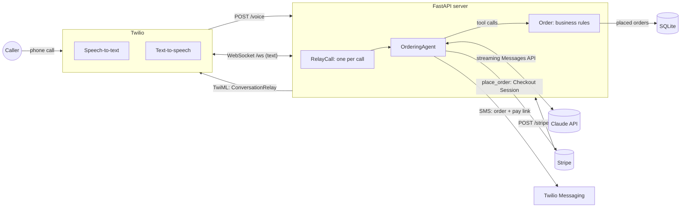
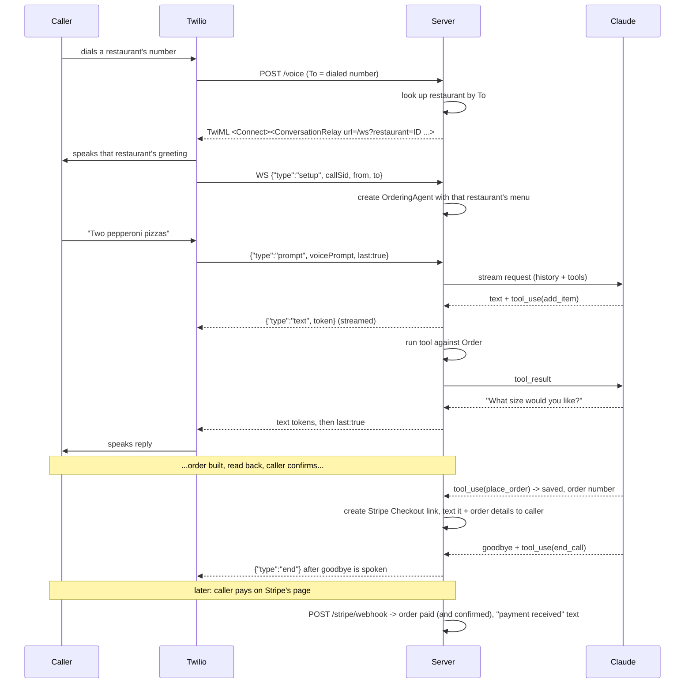

# High-Level Design: Phone Ordering Agent

Status: demo, hosted on Fly.io since 2026-11-18; no phone order saved yet. Last updated: 2026-11-22.

## 1. Goal

Let a caller phone a restaurant and place a pickup order by talking to an AI agent.
The agent answers menu questions, builds the order, reads it back, places it after
the caller confirms, and gives an order number and pickup time. It then texts the
order details and a secure payment link to the caller, so card details are never
shared over the phone.

**In scope:** pickup orders, menu questions, changing the order during the call,
payment by texted Stripe link (or at pickup).
**Out of scope (for now):** delivery, reservations, complaints, refunds. The agent
says politely that this line only takes pickup orders.

## 2. Architecture

| Component | File | Responsibility |
|---|---|---|
| Twilio ConversationRelay | (Twilio) | Phone line, speech-to-text, text-to-speech, interruption detection. |
| Voice webhook | `ordering_agent/server.py` `/voice` | Finds the restaurant by the dialed number (`To`) and answers with that restaurant's greeting and TwiML that connects the call to ConversationRelay (restaurant id in the `/ws` URL), including voice settings. Unknown numbers get a short apology and hang-up. |
| Restaurant directory | `ordering_agent/restaurants.py` | Maps a dialed number or id to the restaurant's current menu (parsed menus cached by menu version). Also the admin commands: add a restaurant, publish a menu, set its number, activate/deactivate. |
| Relay session | `server.py` `RelayCall`, `/ws` | One per call. Turns relay messages into agent turns, streams reply text back, handles interruptions and hang-up. |
| Agent | `ordering_agent/agent.py` | Streaming Claude tool-use loop for one call. Yields text chunks as they arrive. |
| System prompt | `ordering_agent/prompts.py` | Speaking style for phone, ordering procedure, the full menu. |
| Tools | `ordering_agent/tools.py` | Tool schemas for Claude, input type checks, dispatch to the order. |
| Order | `ordering_agent/order.py` | Cart state and all business rules: valid items, required options, extras, quantities, tax, totals. |
| Menu | `ordering_agent/menu.py`; menus stored per restaurant in the database, loaded from `data/restaurants/<slug>.json` files | Restaurant info and settings, optional restaurant notes, and menu, rendered into the prompt deterministically. Validated before it's saved. Dishes sold in several versions (e.g. chicken/fish/shrimp) are one item with a required option priced as deltas from the cheapest version. Tests use `tests/fixtures/menu.json`. |
| Payments | `ordering_agent/payments.py` | Creates a Stripe Checkout link per order, texts it with the order details via Twilio, applies Stripe webhook events (paid / expired) to the order. |
| Stripe webhook | `server.py` `/stripe/webhook`, `/paid` | Verifies Stripe's signature and updates payment and order status; `/paid` is the page shown after paying. |
| Storage | `ordering_agent/storage.py` | Restaurants, menu versions, placed orders (order and payment status, per-restaurant order numbers) and call transcripts, in SQLite. All SQL is in this file. Adds new columns to older databases on startup. |
| Terminal client | `ordering_agent/cli.py` | Same agent without a phone, for testing. |
| Orders dashboard | `server.py` `/dashboard`, `/orders`, `/calls`; `ordering_agent/static/dashboard.html` | Staff view of phone orders: today's count and sales, each order's items, total, order and payment status; filter, search, refreshes every 10 s. A Calls tab lists every call (with or without an order) and its transcript. The page holds no data and reads the API with the admin token. |

## 3. Call flow

**Payment rule (per restaurant, `restaurant.payment` in the restaurant's menu):**
- `required_before_cooking: false` (default): the order is confirmed right away; paying
  by link is optional and the caller can pay at pickup.
- `required_before_cooking: true`: the order is saved as `awaiting_payment` and only
  becomes `confirmed` when Stripe reports it paid. If the link expires unpaid
  (`pay_within_minutes`, 30 minutes to 24 hours, Stripe's limits), the order is
  `cancelled` and the caller gets a text saying so.

**Interruptions:** when the caller talks over the agent, Twilio sends `interrupt` (or
a new prompt arrives). If the reply is only talking, the server cancels it. If the model
has started a tool call (for example `place_order`, which also calls Stripe and Twilio),
cancelling would lose the order or leave a tool call without its result in the history,
so instead the reply is muted: the tool finishes, its result is recorded, nothing more
is spoken, and the server waits (up to 30 s) before handling what the caller said.
Either way the agent's next turn is told what the caller actually heard, and that any
tool results after that point haven't been announced.

**Transcripts:** every call gets a row in `calls` and a line in `call_events` for each
thing that happened, in order: the greeting, what the caller said (as Twilio heard it),
what the agent said (marked when cut off), each tool call with its input and result,
interruptions and the call's end. Staff read them on the dashboard's Calls tab. This
is how to find out why a call didn't produce an order.

## 4. Key design decisions

| Decision | Why |
|---|---|
| **Messages API, loop hosted in our server** (not Managed Agents) | Phone calls need the lowest latency: streaming tokens go straight to speech. The tools are local functions, so there's no need for a hosted sandbox. |
| **Twilio ConversationRelay** for speech | Twilio handles speech-to-text, text-to-speech and interruption detection. We only deal with text. The speech provider and voice are configuration, not code. |
| **Menu in the system prompt**, not a lookup tool | Menu questions need no tool round-trip, which saves latency. The prompt is identical across calls, so it's cached. |
| **All prices and rules in code** (`order.py`) | The model can't invent items, skip required options, or miscompute totals. Tool errors are returned to the model so it can ask the caller. |
| **Confirm before placing** | `place_order` requires `caller_confirmed: true` and the prompt requires a read-back first. |
| **Model `claude-opus-5-5` at `low` effort** | Short, quick turns for the phone. Effort and fast mode are configurable. |
| **Pay by texted Stripe Checkout link**, not card details by voice | Customers never read card numbers to an AI or over a phone line, and we never handle card data (Stripe does). The link has the exact items and total. |
| **Pay-first is a restaurant setting** | Some restaurants want prepayment to avoid no-shows, others don't. It's a rule in the menu file, enforced in code, and the prompt tells the caller which applies. |
| **Server-side refusal fallback** (`fallbacks: "default"`) | If a turn is declined, the API retries on a fallback model so the caller isn't left in silence. |
| **Streamed tool inputs** (`eager_input_streaming`) with our own validation | Lower latency. The API doesn't validate streamed inputs, so `tools.py` checks types and `order.py` checks rules. |

## 5. State and scaling

- **Per-call state** (conversation history, the order in progress) lives in memory on
  the call's WebSocket connection. A call stays on one server instance for its whole
  duration, so instances share nothing during a call.
- **Scaling out:** run more instances behind a load balancer that supports WebSockets.
  No sticky sessions or shared cache needed. One `AsyncAnthropic` client per process
  pools connections, and each call is a lightweight asyncio task.
- **Shared state** is only placed orders. SQLite is fine for one instance; use a shared
  database or send orders to the POS for more.
- **Simultaneous calls:** a Twilio number is not a single line. Every incoming call gets
  its own `/voice` request and its own WebSocket, so several callers can order at once and
  nobody gets a busy signal. On our side each call is one WebSocket; `fly.toml` caps a
  machine at 100 connections (soft limit 50). If a restaurant forwards its existing
  number to ours, its phone carrier decides how many calls it forwards at once; check
  that per restaurant.
- **Limits to plan for:** Anthropic rate limits at peak concurrent calls, and Twilio
  concurrency on the account.
- **Hosting:** Fly.io (`Dockerfile`, `fly.toml`), one always-on `shared-cpu-1x` machine
  in `ord` (Chicago) with a 1 GB volume at `/data` for `orders.db`. Always on because a
  cold start would leave a caller in silence; one machine because SQLite lives on one
  volume. Secrets are Fly secrets, never in the image (`.dockerignore` excludes `.env`
  and local databases). Live at `https://phone-ordering-agent-604b.fly.dev` (region
  `ord`); the Twilio number's voice webhook points there.
  Local development still works with uvicorn plus a tunnel.

## 6. Data model

- **Restaurant:** id, slug (e.g. `hyderabad-house`), the Twilio number callers dial
  (unique), active flag, current menu version.
- **Menu version:** restaurant, time, the full menu JSON (items plus the `restaurant`
  settings block: name, hours, address, tax rate, pickup minutes, payment rule, notes).
  Publishing a menu adds a version; old ones are kept.
- **Order:** lines, customer name, caller phone (from Twilio, not from the model),
  order type (pickup), placed flag. Subtotal, tax and total are computed.
- **Line item:** line_id, menu item, quantity, chosen options, extras, kitchen notes,
  unit price (computed from the menu).
- **Saved order row:** internal id, restaurant, per-restaurant order number (each
  restaurant's first order is #1), time, Twilio call SID, name, phone, total, full
  order summary as JSON, order status (`confirmed` / `awaiting_payment` / `cancelled`),
  payment status (`not_requested` / `unpaid` / `paid` / `expired`), Stripe Checkout
  Session ID and URL, paid time.
- **Call row:** Twilio call SID, restaurant, start and end time, caller phone, order number (if any).
- **Call event:** call SID, time, role (`caller` / `agent` / `tool` / `event`), text
  (at most 4,000 characters).
- **Phone numbers** are stored in E.164 form (`+15551234567`).

## 7. Agent tools

| Tool | Effect |
|---|---|
| `add_item` | Add a menu item with options, extras, notes. Rejects unknown items, missing required options, invalid extras. |
| `remove_item` | Remove a line. |
| `update_quantity` | Change a line's quantity; 0 removes it. |
| `view_order` | Current lines, subtotal, tax, total. |
| `set_customer_name` | Name the order is under. |
| `set_customer_phone` | Mobile number for the text, when it differs from caller ID or caller ID is hidden. Must be a full number. |
| `place_order` | Save the order; requires caller confirmation, a name, at least one item, and (with payments on) a phone number. Then creates the payment link and texts it; the result tells the agent whether it was sent. |
| `end_call` | Hang up after the goodbye. |

## 8. Configuration

All settings are environment variables; see `.env.example` and the README table.
Groups: Claude (model, effort, fast mode), voice (text-to-speech and speech-to-text
provider, voice, language, extra ConversationRelay attributes), Twilio (auth token,
public URL, account SID and SMS sender number), Stripe (secret key, webhook secret),
storage (database file; menu file for the terminal chat), admin (`/orders` token). Payment links are on
only when `STRIPE_SECRET_KEY` and the Twilio SMS settings are all set; otherwise
customers pay at pickup. Per-restaurant settings (tax, pickup time, pay-first rule,
hours, notes) live in each restaurant's menu, not in environment variables.

## 9. Security

- `/voice` validates Twilio's request signature when `TWILIO_AUTH_TOKEN` is set.
- `/ws` rejects a bad signature (checked over the full URL, including the restaurant
  id), but doesn't yet require one (open issue). The restaurant id in the URL is
  cross-checked against the dialed number in the setup message; a mismatch is logged.
- Every order and call row carries its restaurant, and the APIs filter by it. Until
  staff logins exist, the single `ORDERS_API_TOKEN` sees every restaurant, so only the
  operator should have it.
- `/orders`, `/calls` and `/dashboard` (customer names, phone numbers, call
  transcripts) are off unless `ORDERS_API_TOKEN` is set. The dashboard page has no data in it; it sends the token
  (kept in the browser's local storage) as a Bearer header, compared in constant time.
- The phone number defaults to caller ID from Twilio. The caller can give a different
  number for the text (`set_customer_phone`); the agent reads back the last four digits
  before placing the order.
- No card data touches this server or the call: payment happens on Stripe's page.
- `/stripe/webhook` is off unless `STRIPE_WEBHOOK_SECRET` is set, and rejects events
  without a valid Stripe signature. Retried events don't change state twice or send
  duplicate texts.
- `RELAY_EXTRA_ATTRS` can't override `url` or `welcomeGreeting`.

## 10. Failure handling

| Failure | Behavior |
|---|---|
| Claude API error | Agent says it's having trouble and asks the caller to repeat. |
| Refusal (after fallback) | Agent politely steers back to the menu. |
| Unparseable streamed tool input | Turn retried up to twice, then the error line. |
| Runaway tool loop | Capped at 8 model rounds per caller turn. |
| Invalid tool input or rule violation | Error returned to the model, which asks the caller. |
| Caller hangs up | WebSocket closes. A reply that is only talking is cancelled; one mid tool call finishes first, so a confirmed order is still saved. The call's end is recorded. |
| Caller interrupts mid tool call | The tool finishes silently, then the agent answers the new speech knowing what wasn't heard. If it takes over 30 s it's cancelled. |
| Transcript write fails | Logged; the call carries on. |
| Stripe or SMS fails at `place_order` | The order is still saved. The agent tells the caller the text didn't go through and they can pay at pickup (pay-first restaurants: the order starts when they pay at the counter). |
| Text after payment fails | Logged; payment status is still updated. |

## 11. Testing

`python -m pytest` runs with a scripted fake Claude client (`tests/fakes.py`), with no
API key or network. Coverage: order rules, tool validation, the agent loop, TwiML and
voice settings, signature rejection, a full phone order over the WebSocket, phone
number checks, both payment rules (optional and pay-first), link/SMS failure, Stripe
webhook signature checks and duplicate events (with fake Stripe and SMS), an
interruption during `place_order` (order still saved, history stays valid), call
transcripts through `/calls`, and multiple restaurants: routing by dialed number,
unknown and inactive numbers, per-restaurant order numbers, API filtering, payment texts
in the right restaurant's name, migrating a pre-restaurant database, and admin-command
validation.

## 12. Multi-restaurant plan (phase 1 built, except Postgres)

Goal: one deployment serves many restaurants. Each call is routed to one restaurant,
and each restaurant's menu, settings, orders, transcripts, staff and money are kept
separate. The agent, tools and order rules are already restaurant-neutral (everything
restaurant-specific is in the restaurant's menu file), so the change is mostly data, routing and
accounts.

**What changes**

| Today | Multi-restaurant |
|---|---|
| One menu file, loaded at startup | `restaurants` table plus versioned menus in the database, loaded per call and cached |
| One Twilio number to `/voice` | A number per restaurant; the dialed number (`To`) selects the restaurant |
| Orders and calls have no restaurant column; one order-number sequence | `restaurant_id` on every row; order numbers counted per restaurant |
| One shared dashboard token | Staff logins scoped to one restaurant |
| One Stripe key; all money to one account | Stripe Connect: each restaurant connects its own Stripe account and is paid directly; optional platform fee |
| One SMS sender | The restaurant's own number sends its texts; A2P 10DLC registration per restaurant brand (Twilio ISV flow) |
| SQLite on one machine | Postgres (multiple machines, backups) |
| Tax, hours, pickup time, pay-first rule in the menu file | Per-restaurant settings, editable in an admin page |

**Call routing**

1. `/voice` (Twilio-signed) looks up the restaurant by the dialed number and returns
   that restaurant's greeting. Unknown number: a short apology and hang up.
2. The `/ws` URL in the TwiML carries the restaurant ID. Twilio signs that URL, so the
   `/ws` signature becomes required (it is optional today).
3. The agent is built from that restaurant's menu, settings and payment account. The
   system prompt differs only in the menu block, so prompt caching works per restaurant.
4. Orders, transcripts, texts and payment links are tagged with the restaurant; the
   Stripe webhook (Connect events carry the connected account) finds the order through it.

Restaurants can keep their published number and forward calls to ours, either always or
only when staff don't pick up ("no answer" forwarding is an easy first step for them).

**New components**

- Onboarding: menu photos to structured menu data with Claude vision, then a review screen
  where the restaurant confirms prices and required options before going live.
- Restaurant admin: menu editing, "sold out today", hours (the agent knows when the
  restaurant is closed), tax, pickup time, pay-first rule, voice.
- Kitchen hand-off: the dashboard first; POS connectors (Toast, Square, Clover) later, one
  adapter per POS.
- Tenant-isolation tests: no query, endpoint or webhook may return another restaurant's data.
- Later: billing restaurants for the service (Stripe Billing).

**Phases**

1. **Done 2026-11-22 (on SQLite):** restaurants table, routing by dialed number,
   `restaurant_id` on orders and calls, per-restaurant order numbers, versioned menus
   in the database, admin commands, restaurant picker on the dashboard. Hyderabad House
   is restaurant #1. **Still to do:** move to Postgres (provider not chosen; Netlify
   Database was looked at and isn't a fit, since it's tied to apps deployed on Netlify;
   Neon directly or Fly Managed Postgres are the candidates).
2. Staff logins and per-restaurant dashboards.
3. Stripe Connect and per-restaurant SMS (needed before payment links go live for anyone).
4. Onboarding from photos and the admin page, so restaurant #2 needs no hand-edited JSON.
   Until then, onboarding is done with the Claude Code skill
   `.claude/skills/add-restaurant/` (menu file from photos, `check_menu.py`, Twilio
   number, registration on Fly, signed test call). Menu files live in git at
   `data/restaurants/<slug>.json` and ship in the image; `restaurant.placeholders` and
   `placeholder_price` mark guessed values, which the checker blocks on.
5. POS integrations as restaurants ask for them.

**Decisions**

- Phone numbers: bought in our main Twilio account, one per restaurant (decided
  2026-11-22). Subaccounts can come later if billing needs separating.
- Chains: not in scope for now; each restaurant is one location (decided 2026-11-22).
  A chain's locations can be separate restaurants; a brand level can be added later.
- Database: Postgres provider still to choose.

## 13. Open issues and next steps

- One short live call completed end to end; a full order over the phone hasn't been placed
  yet. ConversationRelay message field names still need confirming against the docs.
- Menu gaps: address and hours are not set. Drinks, shakes, desserts and pastries (17
  items tagged `"placeholder_price": true` in `data/restaurants/hyderabad-house.json`) use typical prices, not the
  restaurant's; confirm or correct them before real customers order. Daily specials
  aren't on the phone menu; the agent offers them at the counter.
- The full menu adds roughly 6k tokens to the (cached) system prompt; watch first-turn latency.
- Hang-up delay after the goodbye is estimated from word count; tune after real calls.
- Require a Twilio signature on `/ws`.
- DTMF (keypad) input is ignored.
- Payments not yet tried live: needs Stripe keys, the webhook registered in Stripe, and
  US SMS registration (A2P 10DLC) for the Twilio number, or US carriers block the texts.
- The dashboard is read-only: no "ready" / "picked up" status, and it polls rather than
  pushing new orders. Cancelled pay-first orders show there but aren't announced.
- The dashboard token is one shared secret that sees every restaurant; staff logins
  scoped to one restaurant are phase 2.
- Refunds and order changes after payment are handled manually in Stripe.
- Before scaling past one Fly machine, move to Postgres (SQLite is on one volume). Order
  numbers are assigned as max + 1 under a process lock, which is only safe on one
  machine; Postgres needs a per-restaurant counter or a unique constraint with retry.
- Transcripts are kept forever and include names and phone numbers; add a retention
  period (delete after N days) before real customers call.
- The first live order that wasn't saved (call `CA277d47…`, before transcripts) is still
  unexplained; the next failed call will have a transcript to check.
- Multi-restaurant support (section 12): finish phase 1 with Postgres, then phase 2
  (staff logins). Payment texts still come from one `TWILIO_SMS_FROM` number for every
  restaurant until phase 3.
- Possible features: delivery, POS integration, kitchen display.

## 14. Change log

| Date | Change |
|---|---|
| 2026-11-18 | Initial design: Claude Messages API agent, Twilio ConversationRelay, order tools, SQLite storage, terminal client. |
| 2026-11-18 | Text-to-speech and speech-to-text provider, voice and language made configurable via environment variables. |
| 2026-11-18 | Added this design document. |
| 2026-11-18 | Replaced the placeholder pizza menu with a real Indian restaurant menu; added restaurant notes to the prompt; tests moved to a fixture menu. |
| 2026-11-18 | Pay by text: Stripe Checkout link per order sent by SMS with the order details, Stripe webhook for paid/expired, pay-first rule per restaurant, `set_customer_phone` tool, order and payment status in storage. |
| 2026-11-18 | Orders dashboard at `/dashboard` (reads `/orders`, which now takes `limit`). |
| 2026-11-18 | Hosting on Fly.io: Dockerfile, fly.toml, one always-on machine with a volume for orders. |
| 2026-11-18 | Call transcripts (`calls`, `call_events` tables, `/calls` API, dashboard Calls tab). Interruptions during a tool call no longer cancel it, so a confirmed order can't be lost to the caller talking over the agent. |
| 2026-11-18 | Deployed to Fly.io (`phone-ordering-agent-604b`); Twilio number moved off the cloudflared tunnel. |
| 2026-11-18 | Restaurant named Hyderabad House. Agent no longer tells callers to phone the restaurant; unpriced desserts/drinks/specials are offered at the counter instead. |
| 2026-11-22 | Drinks, shakes, desserts and pastries added to the phone menu with placeholder prices (`placeholder_price` tag). Only daily specials are still counter-only. |
| 2026-11-22 | Multi-restaurant plan (section 12); note on simultaneous calls in section 5. |
| 2026-11-22 | Multi-restaurant phase 1 on SQLite: restaurants and versioned menus in the database, calls routed by dialed number, `restaurant_id` on orders and calls, per-restaurant order numbers, admin commands (`ordering_agent/restaurants.py`), `/restaurants` API, restaurant filter on `/orders` and `/calls`, dashboard restaurant picker. |
| 2026-11-22 | `add-restaurant` skill and menu checker; menus moved to `data/restaurants/<slug>.json`; `restaurant.placeholders` marks unconfirmed settings (Hyderabad House's tax rate). |
