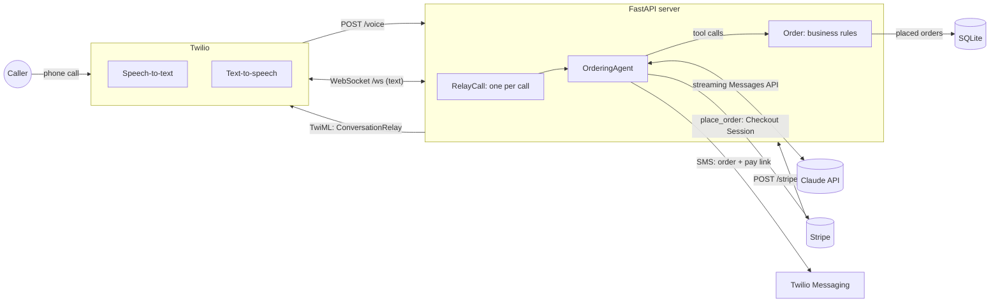
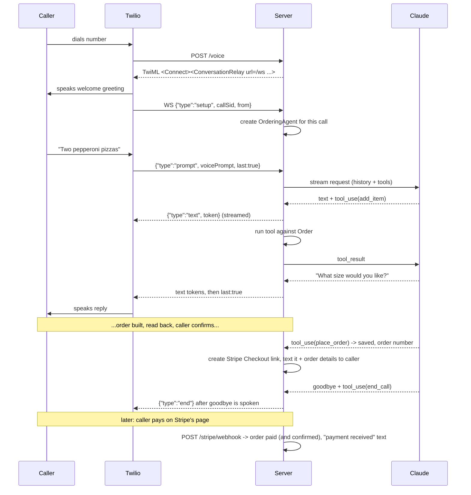

# High-Level Design: Phone Ordering Agent

Status: demo; first live call completed 2026-11-18 (no order placed yet). Last updated: 2026-11-18.

## 1. Goal

Let a caller phone a restaurant and place a pickup order by talking to an AI agent.
The agent answers menu questions, builds the order, reads it back, places it after
the caller confirms, and gives an order number and pickup time. It then texts the
order details and a secure payment link to the caller, so card details are never
shared over the phone.

**In scope:** pickup orders, menu questions, changing the order during the call,
payment by texted Stripe link (or at pickup).
**Out of scope (for now):** delivery, reservations, complaints, refunds. The agent
says politely that this line only takes pickup orders.

## 2. Architecture

| Component | File | Responsibility |
|---|---|---|
| Twilio ConversationRelay | (Twilio) | Phone line, speech-to-text, text-to-speech, interruption detection. |
| Voice webhook | `ordering_agent/server.py` `/voice` | Answers the call with TwiML that connects it to ConversationRelay, including voice settings. |
| Relay session | `server.py` `RelayCall`, `/ws` | One per call. Turns relay messages into agent turns, streams reply text back, handles interruptions and hang-up. |
| Agent | `ordering_agent/agent.py` | Streaming Claude tool-use loop for one call. Yields text chunks as they arrive. |
| System prompt | `ordering_agent/prompts.py` | Speaking style for phone, ordering procedure, the full menu. |
| Tools | `ordering_agent/tools.py` | Tool schemas for Claude, input type checks, dispatch to the order. |
| Order | `ordering_agent/order.py` | Cart state and all business rules: valid items, required options, extras, quantities, tax, totals. |
| Menu | `data/menu.json`, `ordering_agent/menu.py` | Restaurant info, optional restaurant notes, and menu, rendered into the prompt deterministically. Dishes sold in several versions (e.g. chicken/fish/shrimp) are one item with a required option priced as deltas from the cheapest version. Tests use `tests/fixtures/menu.json`. |
| Payments | `ordering_agent/payments.py` | Creates a Stripe Checkout link per order, texts it with the order details via Twilio, applies Stripe webhook events (paid / expired) to the order. |
| Stripe webhook | `server.py` `/stripe/webhook`, `/paid` | Verifies Stripe's signature and updates payment and order status; `/paid` is the page shown after paying. |
| Storage | `ordering_agent/storage.py` | Saves placed orders (SQLite) with order status and payment status. Adds new columns to older databases on startup. |
| Terminal client | `ordering_agent/cli.py` | Same agent without a phone, for testing. |
| Orders dashboard | `server.py` `/dashboard`, `/orders`; `ordering_agent/static/dashboard.html` | Staff view of phone orders: today's count and sales, each order's items, total, order and payment status; filter, search, refreshes every 10 s. The page holds no data and reads `/orders` with the admin token. |

## 3. Call flow

**Payment rule (per restaurant, `restaurant.payment` in `data/menu.json`):**
- `required_before_cooking: false` (default): the order is confirmed right away; paying
  by link is optional and the caller can pay at pickup.
- `required_before_cooking: true`: the order is saved as `awaiting_payment` and only
  becomes `confirmed` when Stripe reports it paid. If the link expires unpaid
  (`pay_within_minutes`, 30 minutes to 24 hours, Stripe's limits), the order is
  `cancelled` and the caller gets a text saying so.

**Interruptions:** when the caller talks over the agent, Twilio sends `interrupt`. The
server cancels the reply in progress, and the agent's next turn is told what the caller
actually heard.

## 4. Key design decisions

| Decision | Why |
|---|---|
| **Messages API, loop hosted in our server** (not Managed Agents) | Phone calls need the lowest latency: streaming tokens go straight to speech. The tools are local functions, so there's no need for a hosted sandbox. |
| **Twilio ConversationRelay** for speech | Twilio handles speech-to-text, text-to-speech and interruption detection. We only deal with text. The speech provider and voice are configuration, not code. |
| **Menu in the system prompt**, not a lookup tool | Menu questions need no tool round-trip, which saves latency. The prompt is identical across calls, so it's cached. |
| **All prices and rules in code** (`order.py`) | The model can't invent items, skip required options, or miscompute totals. Tool errors are returned to the model so it can ask the caller. |
| **Confirm before placing** | `place_order` requires `caller_confirmed: true` and the prompt requires a read-back first. |
| **Model `claude-opus-5-5` at `low` effort** | Short, quick turns for the phone. Effort and fast mode are configurable. |
| **Pay by texted Stripe Checkout link**, not card details by voice | Customers never read card numbers to an AI or over a phone line, and we never handle card data (Stripe does). The link has the exact items and total. |
| **Pay-first is a restaurant setting** | Some restaurants want prepayment to avoid no-shows, others don't. It's a rule in the menu file, enforced in code, and the prompt tells the caller which applies. |
| **Server-side refusal fallback** (`fallbacks: "default"`) | If a turn is declined, the API retries on a fallback model so the caller isn't left in silence. |
| **Streamed tool inputs** (`eager_input_streaming`) with our own validation | Lower latency. The API doesn't validate streamed inputs, so `tools.py` checks types and `order.py` checks rules. |

## 5. State and scaling

- **Per-call state** (conversation history, the order in progress) lives in memory on
  the call's WebSocket connection. A call stays on one server instance for its whole
  duration, so instances share nothing during a call.
- **Scaling out:** run more instances behind a load balancer that supports WebSockets.
  No sticky sessions or shared cache needed. One `AsyncAnthropic` client per process
  pools connections, and each call is a lightweight asyncio task.
- **Shared state** is only placed orders. SQLite is fine for one instance; use a shared
  database or send orders to the POS for more.
- **Limits to plan for:** Anthropic rate limits at peak concurrent calls, and Twilio
  concurrency on the account.
- **Hosting:** Fly.io (`Dockerfile`, `fly.toml`), one always-on `shared-cpu-1x` machine
  in `ord` (Chicago) with a 1 GB volume at `/data` for `orders.db`. Always on because a
  cold start would leave a caller in silence; one machine because SQLite lives on one
  volume. Secrets are Fly secrets, never in the image (`.dockerignore` excludes `.env`
  and local databases). Fixed URL `https://<app>.fly.dev` for Twilio and Stripe.
  Local development still works with uvicorn plus a tunnel.

## 6. Data model

- **Order:** lines, customer name, caller phone (from Twilio, not from the model),
  order type (pickup), placed flag. Subtotal, tax and total are computed.
- **Line item:** line_id, menu item, quantity, chosen options, extras, kitchen notes,
  unit price (computed from the menu).
- **Saved order row:** order number, time, Twilio call SID, name, phone, total, full
  order summary as JSON, order status (`confirmed` / `awaiting_payment` / `cancelled`),
  payment status (`not_requested` / `unpaid` / `paid` / `expired`), Stripe Checkout
  Session ID and URL, paid time.
- **Phone numbers** are stored in E.164 form (`+15551234567`).

## 7. Agent tools

| Tool | Effect |
|---|---|
| `add_item` | Add a menu item with options, extras, notes. Rejects unknown items, missing required options, invalid extras. |
| `remove_item` | Remove a line. |
| `update_quantity` | Change a line's quantity; 0 removes it. |
| `view_order` | Current lines, subtotal, tax, total. |
| `set_customer_name` | Name the order is under. |
| `set_customer_phone` | Mobile number for the text, when it differs from caller ID or caller ID is hidden. Must be a full number. |
| `place_order` | Save the order; requires caller confirmation, a name, at least one item, and (with payments on) a phone number. Then creates the payment link and texts it; the result tells the agent whether it was sent. |
| `end_call` | Hang up after the goodbye. |

## 8. Configuration

All settings are environment variables; see `.env.example` and the README table.
Groups: Claude (model, effort, fast mode), voice (text-to-speech and speech-to-text
provider, voice, language, extra ConversationRelay attributes), Twilio (auth token,
public URL, account SID and SMS sender number), Stripe (secret key, webhook secret),
storage (orders database, menu path), admin (`/orders` token). Payment links are on
only when `STRIPE_SECRET_KEY` and the Twilio SMS settings are all set; otherwise
customers pay at pickup. The pay-first rule is per restaurant, in `data/menu.json`.

## 9. Security

- `/voice` validates Twilio's request signature when `TWILIO_AUTH_TOKEN` is set.
- `/ws` rejects a bad signature, but doesn't yet require one (open issue).
- `/orders` and `/dashboard` (customer names and phone numbers) are off unless
  `ORDERS_API_TOKEN` is set. The dashboard page has no data in it; it sends the token
  (kept in the browser's local storage) as a Bearer header, compared in constant time.
- The phone number defaults to caller ID from Twilio. The caller can give a different
  number for the text (`set_customer_phone`); the agent reads back the last four digits
  before placing the order.
- No card data touches this server or the call: payment happens on Stripe's page.
- `/stripe/webhook` is off unless `STRIPE_WEBHOOK_SECRET` is set, and rejects events
  without a valid Stripe signature. Retried events don't change state twice or send
  duplicate texts.
- `RELAY_EXTRA_ATTRS` can't override `url` or `welcomeGreeting`.

## 10. Failure handling

| Failure | Behavior |
|---|---|
| Claude API error | Agent says it's having trouble and asks the caller to repeat. |
| Refusal (after fallback) | Agent politely steers back to the menu. |
| Unparseable streamed tool input | Turn retried up to twice, then the error line. |
| Runaway tool loop | Capped at 8 model rounds per caller turn. |
| Invalid tool input or rule violation | Error returned to the model, which asks the caller. |
| Caller hangs up | WebSocket closes, reply in progress is cancelled. |
| Stripe or SMS fails at `place_order` | The order is still saved. The agent tells the caller the text didn't go through and they can pay at pickup (pay-first restaurants: the order starts when they pay at the counter). |
| Text after payment fails | Logged; payment status is still updated. |

## 11. Testing

`python -m pytest` runs with a scripted fake Claude client (`tests/fakes.py`), with no
API key or network. Coverage: order rules, tool validation, the agent loop, TwiML and
voice settings, signature rejection, a full phone order over the WebSocket, phone
number checks, both payment rules (optional and pay-first), link/SMS failure, Stripe
webhook signature checks and duplicate events (with fake Stripe and SMS).

## 12. Open issues and next steps

- One short live call completed end to end; a full order over the phone hasn't been placed
  yet. ConversationRelay message field names still need confirming against the docs.
- Menu gaps: address and hours are not set. Desserts, pastries, drinks and the daily
  specials have no printed prices, so they can't be phone-ordered yet; the agent says they
  can be added at the counter at pickup.
- The full menu adds roughly 6k tokens to the (cached) system prompt; watch first-turn latency.
- Hang-up delay after the goodbye is estimated from word count; tune after real calls.
- Require a Twilio signature on `/ws`.
- DTMF (keypad) input is ignored.
- Payments not yet tried live: needs Stripe keys, the webhook registered in Stripe, and
  US SMS registration (A2P 10DLC) for the Twilio number, or US carriers block the texts.
- The dashboard is read-only: no "ready" / "picked up" status, and it polls rather than
  pushing new orders. Cancelled pay-first orders show there but aren't announced.
- The dashboard token is one shared secret; use real staff logins before production.
- Refunds and order changes after payment are handled manually in Stripe.
- Before scaling past one Fly machine, move orders to Postgres (SQLite is on one volume),
  and set up volume snapshots/backups for `orders.db`.
- Possible features: delivery, POS integration, kitchen display.

## 13. Change log

| Date | Change |
|---|---|
| 2026-11-18 | Initial design: Claude Messages API agent, Twilio ConversationRelay, order tools, SQLite storage, terminal client. |
| 2026-11-18 | Text-to-speech and speech-to-text provider, voice and language made configurable via environment variables. |
| 2026-11-18 | Added this design document. |
| 2026-11-18 | Replaced the placeholder pizza menu with a real Indian restaurant menu; added restaurant notes to the prompt; tests moved to a fixture menu. |
| 2026-11-18 | Pay by text: Stripe Checkout link per order sent by SMS with the order details, Stripe webhook for paid/expired, pay-first rule per restaurant, `set_customer_phone` tool, order and payment status in storage. |
| 2026-11-18 | Orders dashboard at `/dashboard` (reads `/orders`, which now takes `limit`). |
| 2026-11-18 | Hosting on Fly.io: Dockerfile, fly.toml, one always-on machine with a volume for orders. |
| 2026-11-18 | Restaurant named Hyderabad House. Agent no longer tells callers to phone the restaurant; unpriced desserts/drinks/specials are offered at the counter instead. |
